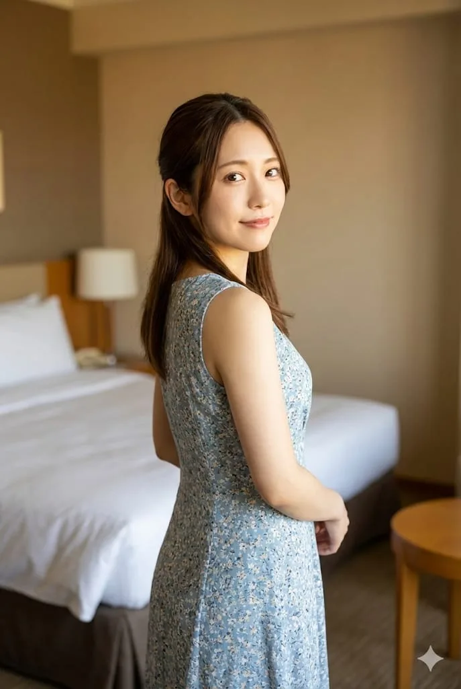

# Minhaa — by @tabu_8114

[← Back to Examples from X](../../EXAMPLES.md) · Category: Photography · Model: `Nano Banana`

<a href="https://x.com/tabu_8114/status/2009265431119646925"></a>

Original post: **[@tabu_8114 on X](https://x.com/tabu_8114/status/2009265431119646925)** · Creator: [Minhaa](https://x.com/tabu_8114)

## Prompt

```text
Gemini Nano Banana Pro 🍌 
{
  "image_type": "photographic portrait",
  "orientation": "vertical",
  "framing": "medium shot",
  "composition": {
    "pose": "standing, torso angled away from camera with head turned back over shoulder",
    "gesture": "arms relaxed, shoulders slightly raised creating a soft curve",
    "body_language": "playful, gentle confidence, approachable",
    "asymmetry": "dynamic asymmetry created by over-the-shoulder pose",
    "negative_space": "moderate negative space above head and around subject within interior setting"
  },
  "subject": {
    "count": 1,
    "gender_presentation": "female",
    "age_appearance": "teenager to young adult",
    "expression": "soft smile, relaxed facial muscles",
    "gaze": "direct eye contact with camera",
    "hair": {
      "color": "medium to dark brown",
      "length": "long",
      "style": "straight, center-parted, tucked behind ears, smooth texture"
    },
    "skin": {
      "tone": "light",
      "texture": "smooth, natural, lightly retouched"
    }
  },
  "wardrobe_and_accessories": {
    "dress": {
      "type": "sleeveless floral dress",
      "base_color": "light blue",
      "pattern": "multicolor floral print",
      "fit": "fitted bodice with gathered skirt",
      "fabric_appearance": "lightweight, soft, slightly matte"
    },
    "accessories": {
      "visible_jewelry": "none prominent",
      "hair_accessories": "none"
    }
  },
  "background": {
    "type": "interior room",
    "setting": "hotel or bedroom",
    "elements": [
      "bed with white linens",
      "side tables",
      "lamp",
      "arched ceiling detail",
      "visible cables on floor"
    ],
    "depth": "background moderately in focus, secondary to subject"
  },
  "lighting": {
    "style": "natural ambient indoor lighting",
    "direction": "soft frontal and side light",
    "contrast": "low",
    "shadows": "very soft, minimal shadowing on face and body",
    "highlights": "gentle highlights on cheeks, eyes, and hair",
    "lighting_quality": "warm, diffused"
  },
  "color_and_tone": {
    "color_mode": "color",
    "white_balance": "warm",
    "palette": "soft pastels and warm neutrals",
    "contrast_curve": "smooth with low contrast",
    "mood": "warm, romantic, candid"
  },
  "camera_and_technical_traits": {
    "camera_distance": "close to medium",
    "lens_appearance": "wide to standard smartphone lens",
    "depth_of_field": "deep, subject and background mostly in focus",
    "sharpness": "high overall clarity",
    "grain": "minimal"
  },
  "artistic_style": {
    "genre": "lifestyle portrait",
    "aesthetic": "candid, feminine, casual elegance",
    "influences": "social media portraiture, lifestyle photography",
    "retouching_style": "light skin smoothing, natural color enhancement"
  },
  "overall_impression": {
    "tone": "friendly, youthful, charming",
    "visual_focus": "face and over-the-shoulder pose",
    "use_case": "social media content, lifestyle reference, casual portrait inspiration"
  },

  "trending_text_overlay": [
    "Dream Military",
    "RESERVE",
    "Virat Kohli"
  ]
}
```

## Try it

Paste the prompt into **[vinano.ai](https://vinano.ai?utm_source=github&utm_medium=readme&utm_campaign=awesome-image-video-prompts-updating&utm_content=x-page-try)** to generate your own version.

> The image and prompt belong to [@tabu_8114](https://x.com/tabu_8114) and are shown here with credit for reference. Creators can ask for changes or removal by opening an issue.
