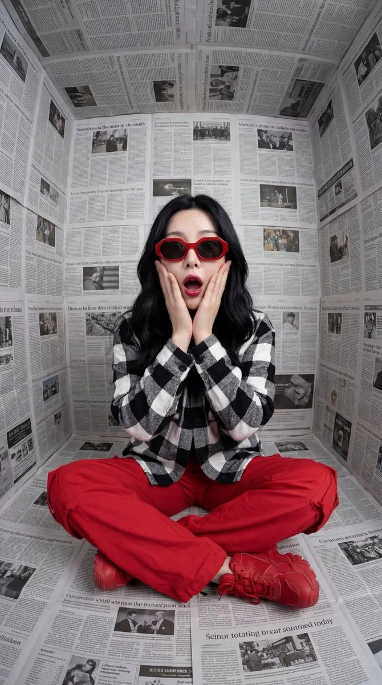

# Taaruk — by @Taaruk_

[← Back to Examples from X](../../EXAMPLES.md) · Category: Photography · Model: `Nano Banana`

<a href="https://x.com/Taaruk_/status/2012011717975556167"></a>

Original post: **[@Taaruk_ on X](https://x.com/Taaruk_/status/2012011717975556167)** · Creator: [Taaruk](https://x.com/Taaruk_)

## Prompt

```text
{
  "Objective": "Create a stylized fashion portrait with bold color contrast and a modern surreal editorial aesthetic",
  "PersonaDetails": {
    "Subject": {
      "Type": "Young woman",
      "Pose": "Sitting cross-legged",
      "Expression": "Dramatic surprise, hands holding cheeks, mouth slightly open",
      "Hair": "Long black hair framing the face",
      "Accessories": "Bold red sunglasses"
    }
  },
  "Wardrobe": {
    "Top": "Black-and-white checkered shirt",
    "Bottom": "Red pants",
    "Footwear": "Red sneakers",
    "ColorTheme": "Vibrant red contrasted against monochrome surroundings"
  },
  "SceneDescription": {
    "Environment": "Small enclosed room",
    "SurfaceTreatment": {
      "Walls": "Covered entirely in newspaper pages",
      "Floor": "Covered entirely in newspaper pages",
      "Ceiling": "Covered entirely in newspaper pages"
    },
    "Concept": "Monochrome newspaper textures creating a graphic, immersive backdrop"
  },
  "Composition": {
    "Framing": "Centered, symmetrical composition",
    "CameraAngle": "Straight-on",
    "Balance": "Strong geometric and visual symmetry",
    "Focus": "Sharp focus across subject and environment"
  },
  "LightingAndColor": {
    "Lighting": "Soft studio lighting",
    "ShadowQuality": "Clean, controlled shadows",
    "Contrast": "High contrast between black-and-white newspapers and red clothing",
    "ColorPalette": [
      "Black",
      "White",
      "Vibrant red"
    ]
  },
  "ArtDirection": {
    "Style": "Editorial fashion photography",
    "Aesthetic": "Modern surrealism",
    "DetailLevel": "Crisp details with high realism",
    "VisualImpact": "Graphic, bold, eye-catching"
  },
  "PhotographyStyle": {
    "Genre": "High-fashion editorial portrait",
    "ImageQuality": "Ultra-high resolution, 8K clarity",
    "Finish": "Clean, sharp, magazine-ready"
  },
  "Mood": {
    "Tone": "Playful shock, surreal curiosity",
    "Energy": "Bold, expressive, contemporary"
  },
  "NegativePrompt": [
    "uneven lighting",
    "blurred details",
    "busy color palette",
    "low contrast",
    "casual snapshot",
    "cartoon style",
    "vintage look"
  ],
  "ResponseFormat": {
    "Type": "Single image",
    "Orientation": "Portrait",
    "AspectRatio": "2:3"
  }
}
```

## Try it

Paste the prompt into **[vinano.ai](https://vinano.ai?utm_source=github&utm_medium=readme&utm_campaign=awesome-image-video-prompts-updating&utm_content=x-page-try)** to generate your own version.

> The image and prompt belong to [@Taaruk_](https://x.com/Taaruk_) and are shown here with credit for reference. Creators can ask for changes or removal by opening an issue.
