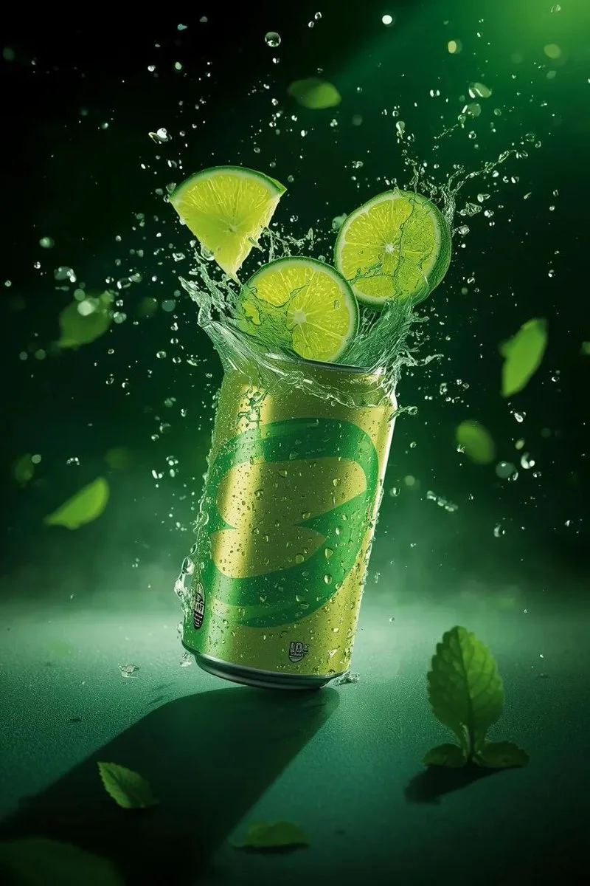

# Kashberg — by @Kashberg_0

[← Back to Community Examples](../../EXAMPLES.md) · Category: Product & Brand · Model: `Nano Banana`

<a href="https://x.com/Kashberg_0/status/2011423604823720358"></a>

Source: **[@Kashberg_0 on X](https://x.com/Kashberg_0/status/2011423604823720358)** · Creator: [Kashberg](https://x.com/Kashberg_0)

## Prompt

```text
A hyper-realistic commercial product shot of a refreshing lime soda can exploding with energy in mid-air. A vibrant green aluminum can covered in condensation, surrounded by sliced limes, mint leaves, and shards of ice, with a dramatic water splash bursting from the top. Lime wedges collide with the can, frozen in motion, droplets suspended in the air. Deep emerald green gradient background with glowing particles, cinematic studio lighting, high contrast highlights, ultra-sharp focus on the can, macro-level texture detail. Dynamic action composition, refreshing summer mood, premium beverage advertising style, photorealistic, 8k resolution.
```

## Try it

Paste the prompt into **[vinano.ai](https://vinano.ai?utm_source=github&utm_medium=readme&utm_campaign=awesome-image-video-prompts-updating&utm_content=x-page-try)** to generate your own version.

> The image and prompt belong to @Kashberg_0 ([original post](https://x.com/Kashberg_0/status/2011423604823720358)) and are shown here with credit for reference. Creators can ask for changes or removal by opening an issue.
