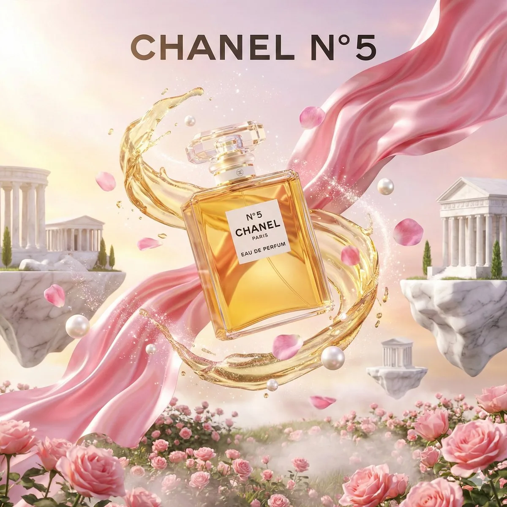

# Iqra Saifi — by @IqraSaifiii

[← Back to Community Examples](../../EXAMPLES.md) · Category: Poster Design · Model: `Nano Banana`

<a href="https://x.com/IqraSaifiii/status/2011788910297563310"></a>

Source: **[@IqraSaifiii on X](https://x.com/IqraSaifiii/status/2011788910297563310)** · Creator: [Iqra Saifi](https://x.com/IqraSaifiii)

## Prompt

```text
High-end 3D advertising poster for [INSERT PRODUCT NAME]. A realistic [INSERT PRODUCT DESCRIPTION] is floating in the center of a magical fantasy landscape. The product is surrounded by a dynamic swirling vortex of [INSERT LIQUID OR ELEMENT] mixed with glowing magical sparkles and floating [INSERT INGREDIENTS]. Background features surreal floating islands made of [INSERT MATERIAL] hovering over a [INSERT LANDSCAPE]. Hyper-realistic CGI render, Octane render, bright cinematic lighting, magical atmosphere. At the bottom center, bold white typography text reads "[INSERT YOUR TAGLINE HERE]". Advertising photography style, 8k resolution --ar 2:3 --v 6.0
```

## Try it

Paste the prompt into **[vinano.ai](https://vinano.ai?utm_source=github&utm_medium=readme&utm_campaign=awesome-image-video-prompts-updating&utm_content=x-page-try)** to generate your own version.

> The image and prompt belong to @IqraSaifiii ([original post](https://x.com/IqraSaifiii/status/2011788910297563310)) and are shown here with credit for reference. Creators can ask for changes or removal by opening an issue.
