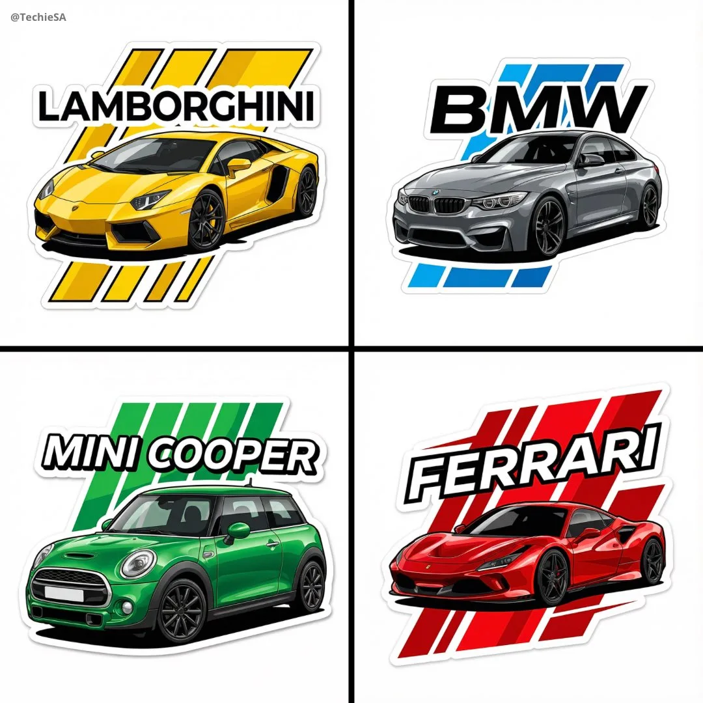

# TechieSA — by @TechieBySA

[← Back to Community Examples](../../EXAMPLES.md) · Category: Illustration & 3D · Model: `Nano Banana`

<a href="https://x.com/TechieBySA/status/2011534895412363546"></a>

Source: **[@TechieBySA on X](https://x.com/TechieBySA/status/2011534895412363546)** · Creator: [TechieSA](https://x.com/TechieBySA)

## Prompt

```text
Create a high-quality vector art illustration of a [COLOR] [BRAND + MODEL] viewed from a dynamic front-side angle, in the style of a modern car sticker design. The car should have detailed shading, black sport rims, and a glossy finish that reflects light. Add the text “[BRAND]” above the car in bold, modern font. Behind the car and text, include angled [STRIPE COLOR] stripes as a background element to add motion and energy. Use a white outline around the entire composition to give the sticker a cutout effect, just like a real die-cut sticker. Place the entire design on a plain white background to mimic how a sticker would appear. The overall design should be sporty, vibrant, and clean. Format: 1080x1080 pixels
```

## Try it

Paste the prompt into **[vinano.ai](https://vinano.ai?utm_source=github&utm_medium=readme&utm_campaign=awesome-image-video-prompts-updating&utm_content=x-page-try)** to generate your own version.

> The image and prompt belong to @TechieBySA ([original post](https://x.com/TechieBySA/status/2011534895412363546)) and are shown here with credit for reference. Creators can ask for changes or removal by opening an issue.
