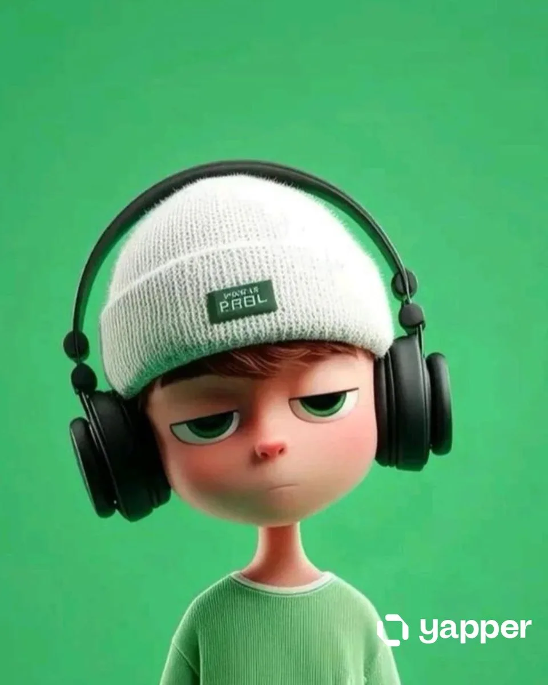

# auqib — by @auqibhabib

[← Back to Examples from X](../../EXAMPLES.md) · Category: Illustration & 3D · Model: `Nano Banana`

<a href="https://x.com/auqibhabib/status/2041096374566228189"></a>

Original post: **[@auqibhabib on X](https://x.com/auqibhabib/status/2041096374566228189)** · Creator: [auqib](https://x.com/auqibhabib)

## Prompt

```text
A stylized 3D cartoon boy character with a minimal, Pixar-like design, pale skin, slightly oversized head, and a slim body. He has half-closed sleepy green eyes, a bored expression, and soft facial features with a small nose and subtle blush. He is wearing a light grey knitted beanie with a small front label, large black over-ear headphones, and a loose green sweatshirt. The character is centered, facing forward, with relaxed posture. Background is a smooth solid green gradient. Soft studio lighting, high detail, clean render, shallow depth of field, ultra-realistic textures, 4K.
```

## Try it

Paste the prompt into **[vinano.ai](https://vinano.ai?utm_source=github&utm_medium=readme&utm_campaign=awesome-image-video-prompts-updating&utm_content=x-page-try)** to generate your own version.

> The image and prompt belong to [@auqibhabib](https://x.com/auqibhabib) and are shown here with credit for reference. Creators can ask for changes or removal by opening an issue.
