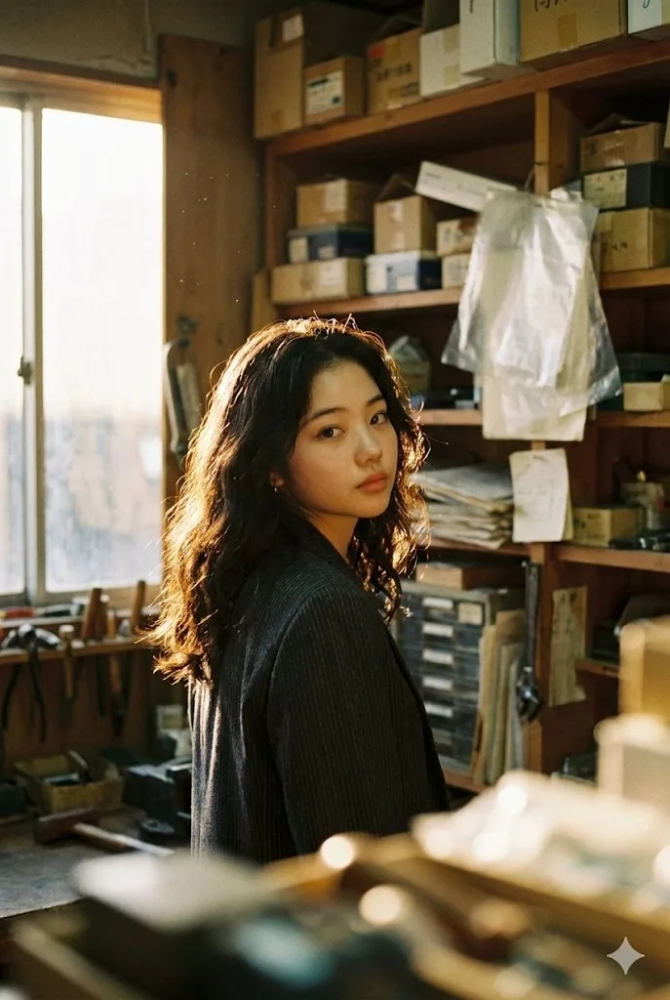

# Minhaa — by @tabu_8114

[← Back to Community Examples](../../EXAMPLES.md) · Category: Photography · Model: `Nano Banana`

<a href="https://x.com/tabu_8114/status/2008765230441246824"></a>

Source: **[@tabu_8114 on X](https://x.com/tabu_8114/status/2008765230441246824)** · Creator: [Minhaa](https://x.com/tabu_8114)

## Prompt

```text
{
  "subject": {
    "description": "Young East Asian woman, positioned in profile turning to look back at the viewer.",
    "pose": "Looking over shoulder, slight head tilt, body angled away from camera.",
    "expression": "Soft, neutral to slightly melancholic, contemplative gaze, lips slightly parted."
  },
  "clothing": {
    "upper_body": "Dark, structured jacket or blazer, possibly pinstriped or textured fabric.",
    "visibility": "Mostly obscured by shadow and foreground elements."
  },
  "hair": {
    "color": "Dark brown to black.",
    "style": "Long, loose, tousled waves, slightly messy texture.",
    "lighting_interaction": "Strongly backlit, creating a glowing halo effect on loose strands (rim lighting)."
  },
  "face": {
    "skin_tone": "Fair/pale with warm undertones.",
    "features": "Soft facial structure, almond-shaped eyes, natural eyebrows.",
    "makeup": "Minimal, 'no-makeup' look, natural lip color."
  },
  "accessories": {
    "visible_items": "None clearly visible due to framing and lighting."
  },
  "environment": {
    "setting": "Cluttered interior space, resembling a workshop, storage room, or old bookstore.",
    "background_elements": "Wooden shelves stacked with indistinct objects, papers, boxes, and plastic packaging.",
    "foreground_elements": "Blurred translucent objects (possibly glass, plastic sheets, or dust covers) creating layers and reflections."
  },
  "lighting": {
    "source": "Natural sunlight streaming through a window on the left.",
    "quality": "Golden hour, warm, diffuse but directional.",
    "effects": "Strong backlighting/rim lighting on hair, volumetric dust motes dancing in the light, lens flares, soft glare, dramatic contrast between light and shadow."
  },
  "camera": {
    "perspective": "Eye-level, shot through a foreground obstruction (glass or clutter).",
    "focus": "Shallow depth of field (bokeh), sharp focus on eyes/face, blurred background and foreground.",
    "lens_character": "Soft focus, film grain simulation, slight bloom effect."
  },
  "style": {
    "aesthetic": "Cinematic, atmospheric, nostalgic, slice-of-life, ethereal.",
    "mood": "Dreamy, intimate, quiet, sentimental.",
    "visual_reference": "Film photography, Japanese photobook style."
  }
}
```

## Try it

Paste the prompt into **[vinano.ai](https://vinano.ai?utm_source=github&utm_medium=readme&utm_campaign=awesome-image-video-prompts-updating&utm_content=x-page-try)** to generate your own version.

> The image and prompt belong to @tabu_8114 ([original post](https://x.com/tabu_8114/status/2008765230441246824)) and are shown here with credit for reference. Creators can ask for changes or removal by opening an issue.
