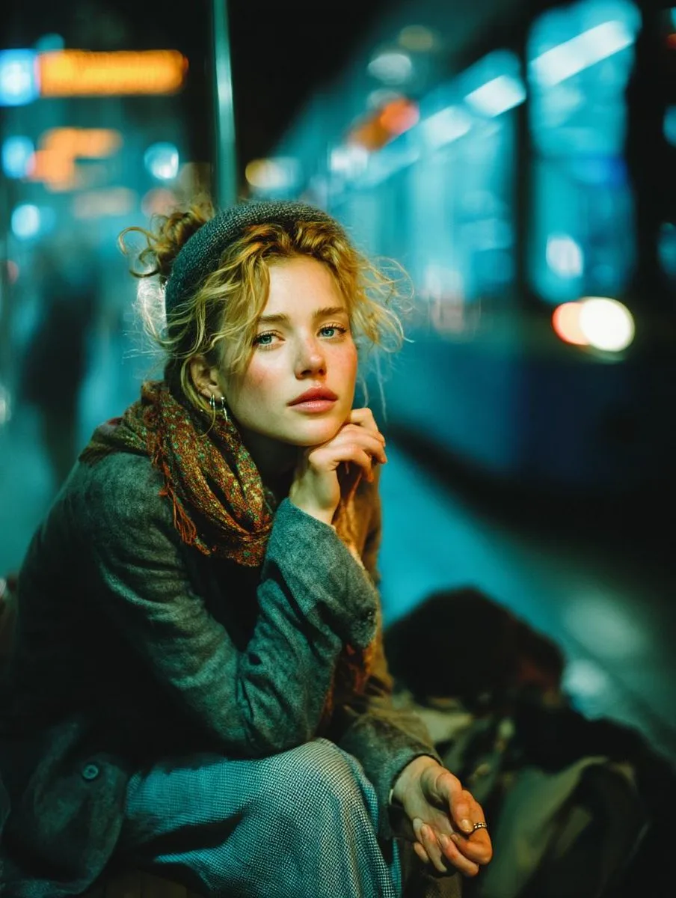

# Taaruk — by @Taaruk_

[← Back to Examples from X](../../EXAMPLES.md) · Category: Photography · Model: `Nano Banana`

<a href="https://x.com/Taaruk_/status/2012144333970133351"></a>

Original post: **[@Taaruk_ on X](https://x.com/Taaruk_/status/2012144333970133351)** · Creator: [Taaruk](https://x.com/Taaruk_)

## Prompt

```text
{
  "Objective": "Create a moody cinematic portrait capturing quiet introspection on a subway platform at night",
  "PersonaDetails": {
    "Subject": {
      "Type": "Young woman",
      "Hair": {
        "Style": "Soft curly blonde hair loosely tied back",
        "Accessory": "Simple headband"
      },
      "FacialDetails": {
        "Freckles": "Natural, visible",
        "Expression": "Calm, introspective, emotionally reserved"
      },
      "Pose": "Seated on a subway bench, resting chin on her hand",
      "Gaze": "Looking slightly downward or into the distance"
    }
  },
  "Wardrobe": {
    "Outerwear": "Textured wool coat",
    "Accessories": "Knitted scarf",
    "ClothingStyle": "Muted, casual, understated urban wear"
  },
  "SceneDescription": {
    "Location": "Subway platform",
    "TimeOfDay": "Night",
    "Environment": {
      "Lighting": "Neon city lights along the platform",
      "Reflections": "Light reflections glowing on metal and tiled surfaces"
    }
  },
  "Composition": {
    "Framing": "Medium cinematic portrait",
    "DepthOfField": "Shallow depth of field",
    "Focus": "Sharp focus on subject with dreamy background blur"
  },
  "LightingAndColor": {
    "Lighting": "Low-light ambient subway illumination",
    "ColorPalette": {
      "Primary": "Cool teal neon tones",
      "Secondary": "Warm amber highlights"
    },
    "Highlights": "Soft highlights with controlled bloom",
    "ColorGrading": "Cinematic, film-inspired night tones"
  },
  "AtmosphericEffects": {
    "Bokeh": "Dreamy neon bokeh in background",
    "FilmGrain": "Subtle film grain for cinematic texture",
    "Mood": "Quiet, reflective, emotionally resonant"
  },
  "ArtDirection": {
    "Style": "Cinematic urban realism",
    "Aesthetic": "Film still / narrative photography",
    "DetailEmphasis": [
      "Natural skin texture",
      "Fabric texture",
      "Light reflections"
    ]
  },
  "PhotographyStyle": {
    "Genre": "Low-light cinematic portrait photography",
    "LensLook": "85mm lens perspective",
    "RealismLevel": "Ultra-realistic",
    "Resolution": "8K detail"
  },
  "Theme": {
    "Concept": "Solitude and reflection in a modern city",
    "EmotionalTone": "Melancholic calm, quiet anticipation"
  },
  "NegativePrompt": [
    "harsh flash",
    "daylight",
    "posed glamour",
    "oversaturated colors",
    "plastic skin",
    "cartoon",
    "anime",
    "blurry subject"
  ],
  "ResponseFormat": {
    "Type": "Single image",
    "Orientation": "Portrait",
    "AspectRatio": "2:3"
  }
}
```

## Try it

Paste the prompt into **[vinano.ai](https://vinano.ai?utm_source=github&utm_medium=readme&utm_campaign=awesome-image-video-prompts-updating&utm_content=x-page-try)** to generate your own version.

> The image and prompt belong to [@Taaruk_](https://x.com/Taaruk_) and are shown here with credit for reference. Creators can ask for changes or removal by opening an issue.
