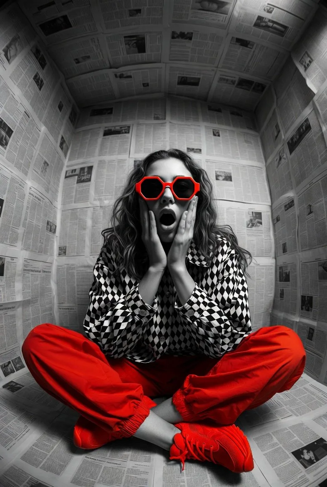

# Sindhu Sherni🦁 — by @SindhuK66662473

[← Back to Community Examples](../../EXAMPLES.md) · Category: Photography · Model: `Nano Banana`

<a href="https://x.com/SindhuK66662473/status/2011031706749522391"></a>

Source: **[@SindhuK66662473 on X](https://x.com/SindhuK66662473/status/2011031706749522391)** · Creator: [Sindhu Sherni🦁](https://x.com/SindhuK66662473)

## Prompt

```text
Hyper-realistic editorial photo shot at eye level with a 12mm ultra-wide lens, full-frame camera, deep focus, and visible barrel distortion with curved room edges. A small rectangular room fully covered in real newspaper pages—walls, floor, and ceiling—showing crisp text, ink bleed, and paper texture.
A woman sits cross-legged on the floor, hands pressed to her cheeks, mouth in a shocked “O.” Long wavy hair, natural skin texture with visible pores and subtle freckles. She wears red octagonal sunglasses, a black-and-white checkered harlequin jacket, vibrant red cargo pants, and matching chunky sneakers.
Soft, diffuse frontal lighting, minimal shadows. Cinematic high-contrast color grade, mostly black and white with red as the only saturated accent, ultra-detailed, photorealistic fashion photography.
```

## Try it

Paste the prompt into **[vinano.ai](https://vinano.ai?utm_source=github&utm_medium=readme&utm_campaign=awesome-image-video-prompts-updating&utm_content=x-page-try)** to generate your own version.

> The image and prompt belong to @SindhuK66662473 ([original post](https://x.com/SindhuK66662473/status/2011031706749522391)) and are shown here with credit for reference. Creators can ask for changes or removal by opening an issue.
