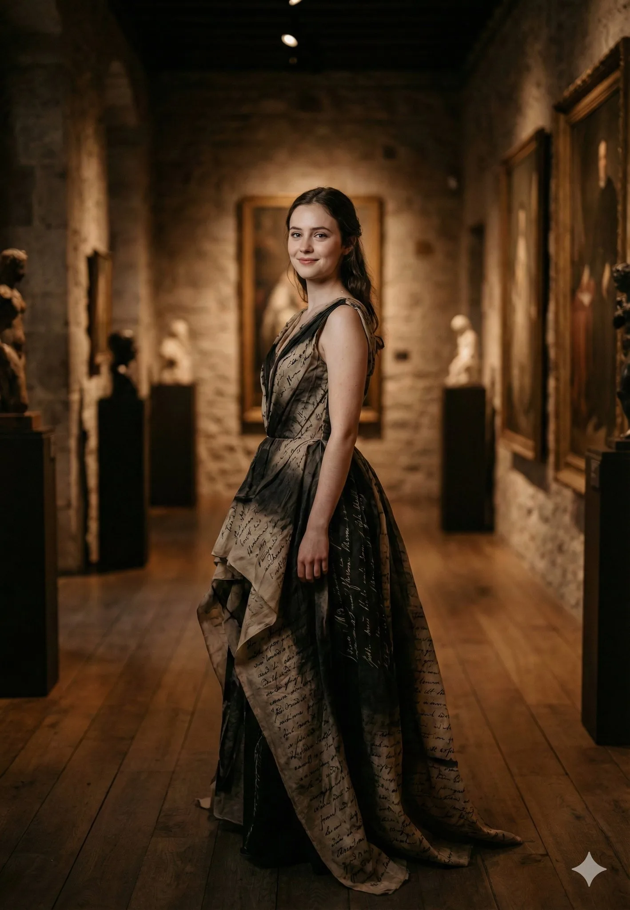

# Maercih — by @Maercihh

[← Back to Examples from X](../../EXAMPLES.md) · Category: Photography · Model: `Nano Banana`

<a href="https://x.com/Maercihh/status/2009212599486042528"></a>

Original post: **[@Maercihh on X](https://x.com/Maercihh/status/2009212599486042528)** · Creator: [Maercih](https://x.com/Maercihh)

## Prompt

```text
{
  "model": "Nano Banana Pro",
  "scene": "Historic art gallery corridor with classical sculptures and framed paintings",
  "subject": {
    "type": "Young woman",
    "pose": "Standing gracefully in three-quarter profile, body slightly turned, hands relaxed",
    "expression": "Soft, confident smile with calm composure",
    "gaze": "Looking gently toward the camera",
    "emotion": "Elegance, quiet confidence, cultural presence"
  },
  "appearance": {
    "hair": {
      "color": "Dark brown",
      "style": "Pulled back neatly with loose natural flow"
    },
    "skin": "Natural complexion, softly illuminated",
    "makeup": "Minimal, refined, classical"
  },
  "attire": {
    "dress": {
      "type": "Flowing couture-style gown",
      "design": "Layered fabric panels printed with handwritten script",
      "colors": "Muted sepia, charcoal, parchment tones",
      "texture": "Soft, draped fabric with subtle sheen"
    },
    "style_note": "Literary, artistic, museum-worthy fashion"
  },
  "environment": {
    "location": "Old stone-walled museum or gallery hall",
    "floor": "Polished wooden floorboards",
    "background_elements": [
      "Classical bust sculptures on pedestals",
      "Large framed paintings along stone walls"
    ],
    "atmosphere": "Quiet, reverent, timeless"
  },
  "lighting": {
    "primary": "Warm gallery spotlights from above",
    "secondary": "Soft ambient lighting along the corridor",
    "effect": "Gentle highlights on fabric folds and face, deep background shadows"
  },
  "camera": {
    "angle": "Eye-level full-body portrait",
    "lens": "50mm cinematic portrait lens",
    "depth_of_field": "Shallow to moderate, subject crisp with softly blurred background",
    "framing": "Vertical composition emphasizing height and elegance"
  },
  "color_palette": {
    "dominant": ["warm amber", "aged parchment brown"],
    "accents": ["deep charcoal", "golden highlights"]
  },
  "mood": "Timeless, cultured, graceful",
  "style": {
    "aesthetic": "Fine-art fashion photography",
    "inspiration": "Classical art, literature, museum couture",
    "realism": "Photorealistic",
    "texture": "Visible fabric grain, stone wall detail",
    "post_processing": "Warm cinematic grading, subtle vignette, gentle contrast"
  },
  "details": {
    "fabric_motion": "Soft drape pooling naturally on the floor",
    "background_depth": "Long corridor perspective enhancing grandeur",
    "motion": "Still, poised moment"
  },
  "themes": [
    "Art and identity",
    "Fashion as language",
    "Timeless beauty",
    "Human presence within history"
  ],
  "quality": "Ultra-detailed, high dynamic range, professional cinematic fine-art portrait"
}
```

## Try it

Paste the prompt into **[vinano.ai](https://vinano.ai?utm_source=github&utm_medium=readme&utm_campaign=awesome-image-video-prompts-updating&utm_content=x-page-try)** to generate your own version.

> The image and prompt belong to [@Maercihh](https://x.com/Maercihh) and are shown here with credit for reference. Creators can ask for changes or removal by opening an issue.
