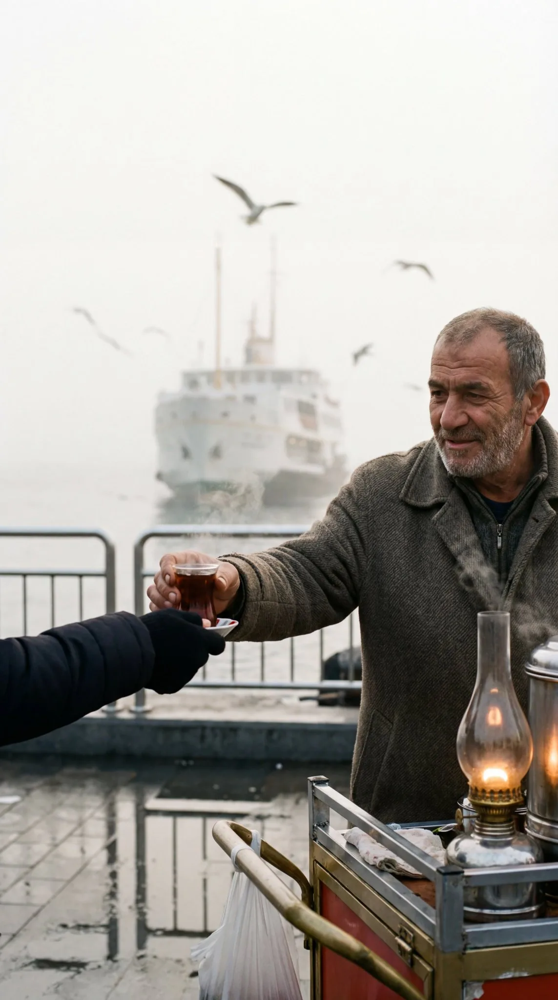

# Özge Döner — by @astronomerozge1

[← Back to Examples from X](../../EXAMPLES.md) · Category: Photography · Model: `Nano Banana`

<a href="https://x.com/astronomerozge1/status/2009224783951487477"></a>

Original post: **[@astronomerozge1 on X](https://x.com/astronomerozge1/status/2009224783951487477)** · Creator: [Özge Döner](https://x.com/astronomerozge1)

## Prompt

```text
{
  "output_settings": {
    "aspect_ratio": "4:5",
    "orientation": "portrait",
    "resolution_target": "ultra_high_res",
    "render_style": "ultra_photoreal_candid_street_film_still",
    "sharpness": "crisp_but_natural",
    "film_grain": "subtle_35mm",
    "color_grade": "restrained_cinematic_realism",
    "dynamic_range": "natural_not_hdr",
    "skin_rendering": "real_texture_no_retouch"
  },
  "global_rules": {
    "camera_language": "35mm lens equivalent, eye-level, imperfect framing, candid documentary feel, focus on eyes when a person is present",
    "authenticity_markers": "subtle halation on highlights, tiny film gate weave, slight background motion blur only, realistic street clutter, no studio look",
    "lighting_language": "motivated natural light only (shop window, street lamp, overcast daylight, sunset), deep but detailed shadows"
  },
  "negative_prompt": [
    "studio lighting",
    "beauty retouch",
    "plastic skin",
    "over-sharpened",
    "HDR",
    "AI glow",
    "perfect symmetry",
    "overly clean background",
    "fake bokeh",
    "text",
    "logo",
    "watermark",
    "cartoon",
    "painterly"
  ]
}
{
  "scene_summary": "Early morning in Eminönü, ferry docks, soft fog and breath in cold air, documentary street realism.",
  "subject": "Tea vendor handing a steaming tea glass to a customer, candid moment.",
  "micro_action": "steam rising as fingers touch the glass, tiny smile",
  "environment_details": "ferry silhouette in mist, seagulls blurred in background, wet railings, puddles",
  "lighting": "soft morning light diffused by fog, highlights with subtle halation"
}
```

## Try it

Paste the prompt into **[vinano.ai](https://vinano.ai?utm_source=github&utm_medium=readme&utm_campaign=awesome-image-video-prompts-updating&utm_content=x-page-try)** to generate your own version.

> The image and prompt belong to [@astronomerozge1](https://x.com/astronomerozge1) and are shown here with credit for reference. Creators can ask for changes or removal by opening an issue.
