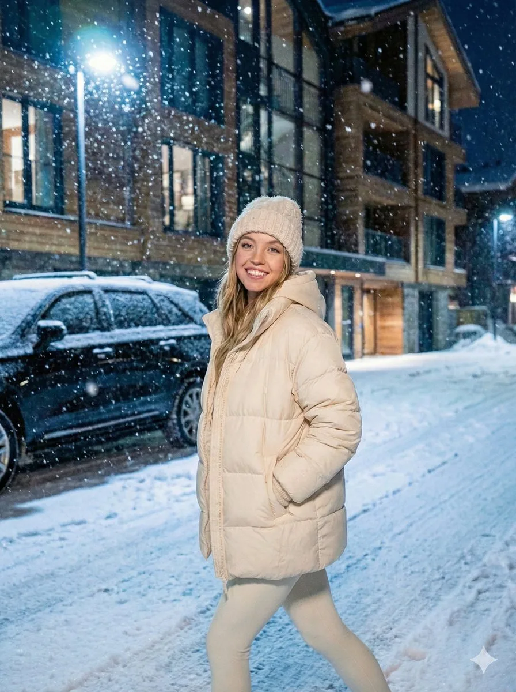

# Selena 🔥 — by @Queen_khan143

[← Back to Community Examples](../../EXAMPLES.md) · Category: Photography · Model: `Nano Banana`

<a href="https://x.com/Queen_khan143/status/2011438269712507284"></a>

Source: **[@Queen_khan143 on X](https://x.com/Queen_khan143/status/2011438269712507284)** · Creator: [Selena 🔥](https://x.com/Queen_khan143)

## Prompt

```text
Ana de Armas
Sydney Sweeney Picture

Gemini Nano Banana Pro

Prompt:
{
  "image_generation_request": {
    "aspect_ratio": "3:4",
    "style": "Cinematic Fashion Photography",
    "quality": "8K / Ultra-High Detail",
    "subject": {
      "identity": "Young adult woman, Shakira-inspired likeness",
      "pose": {
        "description": "Dynamic balletic stance, spontaneous and joyful",
        "position": "Balancing on one leg, other leg bent and lifted high, body slightly tilted",
        "arms": "One arm raised catching snowflakes with open palm, other arm following the flow of movement"
      },
      "expression": {
        "mood": "Genuinely happy and lively",
        "features": "Wide natural smile, slightly parted lips, eyes sparkling with emotion, cheeks flushed from cold"
      },
      "physical_details": {
        "skin": "Realistic texture, fine pores, subtle asymmetry, soft highlights, no plastic smoothing",
        "hair": "Long dark hair flowing from beanie, damp strands clinging to cheeks/forehead from melting snow"
      }
    },
    "apparel": {
      "theme": "Monochrome creamy-white winter look",
      "layers": [
        {
          "item": "Oversized puffer jacket",
          "details": "Thick creamy-white, fluffy texture, visible stitching, realistic down volume and compression folds"
        },
        {
          "item": "Cropped hoodie",
          "details": "Creamy-white soft cotton, gentle wrinkles, worn underneath jacket"
        },
        {
          "item": "High-waisted leggings",
          "details": "Matte stretch fabric, creamy-white, subtle tension at knees and hips"
        }
      ],
      "accessories": [
        {
          "item": "Knit beanie",
          "details": "Extra-fluffy, visible yarn texture, creamy-white"
        },
        {
          "item": "Mittens",
          "details": "Long creamy-white fluffy fibers, catching falling snowflakes"
        }
      ],
      "footwear": {
        "style": "Moon-boot inspired lace-up winter boots",
        "details": "White fur-lined, realistic rubber soles, snow buildup around the edges"
      }
    },
    "environment": {
      "setting": "Nighttime exterior of a modern luxury building",
      "architecture": "Sharp geometric wood with triangular patterns",
      "props": "Black luxury SUV parked nearby, partially covered in frost and snow",
      "ground": "Thick uneven snow blanket with visible footprints and compression points",
      "weather": "Heavy dense snowfall, large snowflakes frozen in mid-motion with slight blur"
    },
    "lighting_and_atmosphere": {
      "primary_lighting": "Cold blue-white ambient winter light",
      "secondary_lighting": "Warm orange glow from building interior/windows",
      "visual_effects": [
        "Cinematic color separation",
        "Soft bokeh highlights in background",
        "Shallow depth of field",
        "Reflections softened by frost"
      ]
    },
    "technical_specs": {
      "camera": "Full-frame DSLR/Mirrorless",
      "lens": "50mm–85mm prime lens aesthetic",
      "optics": "Natural perspective, high dynamic range (HDR), realistic exposure",
      "post_processing": "Authentic textures, no over-sharpening, cinematic realism"
    }
  }
```

## Try it

Paste the prompt into **[vinano.ai](https://vinano.ai?utm_source=github&utm_medium=readme&utm_campaign=awesome-image-video-prompts-updating&utm_content=x-page-try)** to generate your own version.

> The image and prompt belong to @Queen_khan143 ([original post](https://x.com/Queen_khan143/status/2011438269712507284)) and are shown here with credit for reference. Creators can ask for changes or removal by opening an issue.
