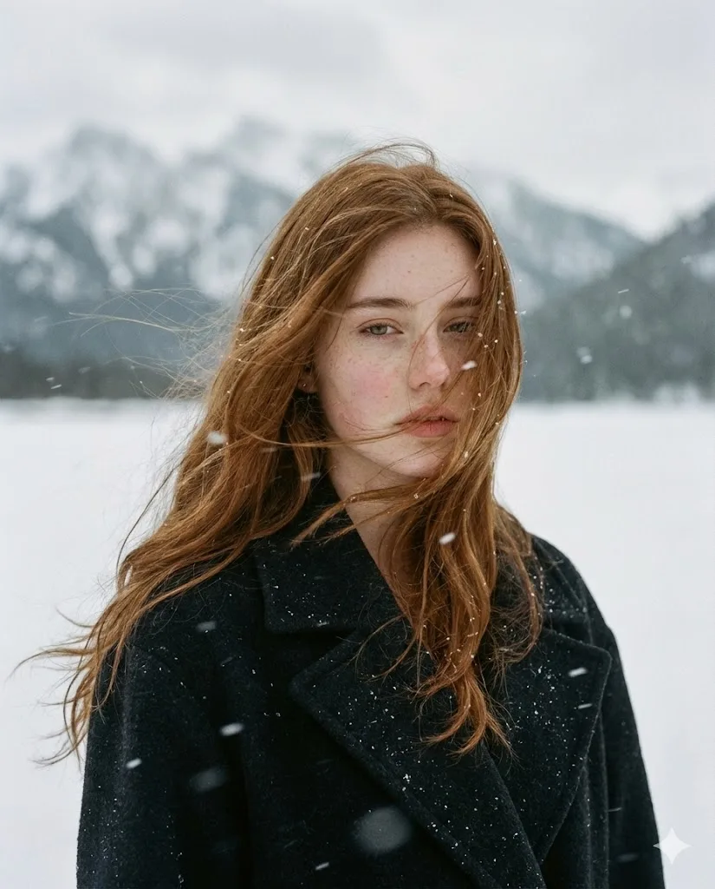

# Harboriis — by @harboriis

[← Back to Examples from X](../../EXAMPLES.md) · Category: Photography · Model: `Nano Banana`

<a href="https://x.com/harboriis/status/2012905632782069864"></a>

Original post: **[@harboriis on X](https://x.com/harboriis/status/2012905632782069864)** · Creator: [Harboriis](https://x.com/harboriis)

## Prompt

```text
A poetic cinematic portrait of a young woman standing alone in a vast snowy landscape, surrounded by distant frost-covered mountains. Her long auburn hair is caught mid-motion by strong winter wind, strands flowing naturally across her face. She wears a dark wool coat, minimal makeup, pale freckled skin, and a quiet, introspective expression. Soft snowfall drifts through the air. Muted natural color palette with cold greys, soft whites, and warm copper hair tones. Shallow depth of field, natural diffused daylight, overcast sky, fine film grain, subtle motion blur in hair and snow, cinematic realism, emotional storytelling, editorial photography, 85mm lens look, ultra-detailed, moody atmosphere, high realism, 8k quality, 4:5 image ratio
```

## Try it

Paste the prompt into **[vinano.ai](https://vinano.ai?utm_source=github&utm_medium=readme&utm_campaign=awesome-image-video-prompts-updating&utm_content=x-page-try)** to generate your own version.

> The image and prompt belong to [@harboriis](https://x.com/harboriis) and are shown here with credit for reference. Creators can ask for changes or removal by opening an issue.
