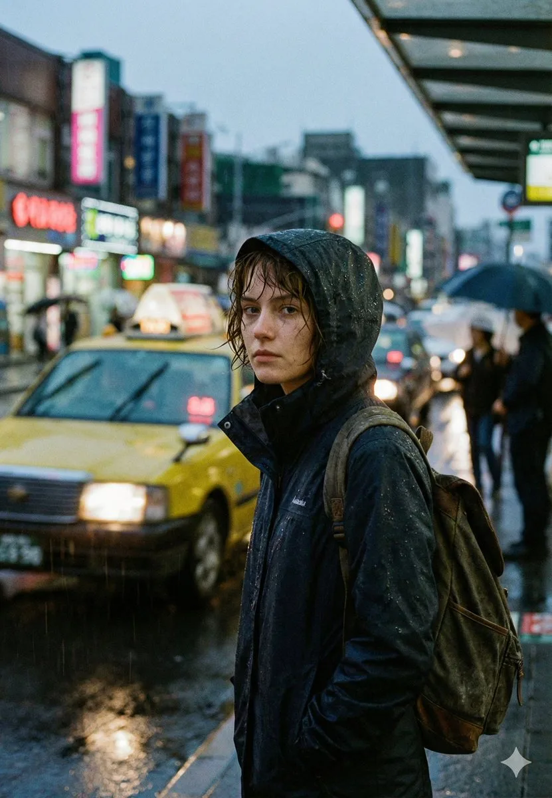

# Maercih — by @Maercihh

[← Back to Community Examples](../../EXAMPLES.md) · Category: Photography · Model: `Nano Banana`

<a href="https://x.com/Maercihh/status/2011680577389502562"></a>

Source: **[@Maercihh on X](https://x.com/Maercihh/status/2011680577389502562)** · Creator: [Maercih](https://x.com/Maercihh)

## Prompt

```text
{
  "project_type": "cinematic_image",
  "title": "Rain Doesn’t Pause the City",
  "creative_direction": {
    "genre": "cinematic urban realism",
    "influences": [
      "modern street photography",
      "neo-noir cinema",
      "documentary realism",
      "architectural urban mood"
    ],
    "emotion": [
      "quiet loneliness",
      "introspection",
      "urban solitude",
      "calm under pressure"
    ]
  },
  "scene": {
    "environment": "dense city street",
    "architecture": "mid-rise commercial buildings with neon signage",
    "time_of_day": "early evening, blue hour",
    "weather": {
      "type": "heavy rain",
      "details": "visible raindrops, wet surfaces, rain streaks in the air"
    },
    "ground": "wet asphalt with reflective puddles"
  },
  "subject": {
    "type": "single human subject",
    "description": "young woman standing alone on the sidewalk",
    "pose": "stationary, body angled slightly away from the camera, head turned toward lens",
    "expression": "neutral, distant, introspective",
    "wardrobe": {
      "outerwear": "dark hooded rain jacket",
      "accessories": ["backpack"],
      "condition": "rain-soaked fabric, visible droplets"
    },
    "physical_details": {
      "hair": "wet, slightly messy, framing the face",
      "skin": "natural texture, no heavy retouching"
    }
  },
  "background": {
    "elements": [
      "yellow taxi with headlights on",
      "blurred moving traffic",
      "pedestrians holding umbrellas",
      "neon shop signs in multiple languages"
    ],
    "depth": "deep urban perspective with layered visual elements",
    "motion_effect": "subtle motion blur on vehicles and pedestrians"
  },
  "cinematography": {
    "camera_type": "full-frame digital cinema camera",
    "lens": "35mm prime",
    "aperture": "wide open for shallow depth of field",
    "focus": "sharp focus on subject, background softly defocused",
    "camera_position": "eye-level, street perspective",
    "movement": "static frame, background motion creates contrast"
  },
  "lighting": {
    "primary_source": "ambient city lighting",
    "secondary_sources": [
      "vehicle headlights",
      "neon signs",
      "storefront lights"
    ],
    "lighting_style": "soft, diffused, natural",
    "contrast": "moderate, cinematic"
  },
  "color_grading": {
    "palette": ["cool blues", "teal shadows", "warm amber highlights"],
    "saturation": "controlled, muted",
    "black_levels": "slightly lifted for filmic look",
    "highlights": "soft roll-off"
  },
  "post_processing": {
    "film_grain": "subtle, cinematic",
    "sharpness": "subject emphasized, background softened",
    "noise": "minimal, natural",
    "vignette": "very subtle"
  },
  "visual_style": {
    "realism": "high",
    "aesthetic": "moody, atmospheric, modern",
    "inspiration_keywords": [
      "cinematic rain",
      "urban isolation",
      "street realism",
      "architectural mood"
    ]
  },
  "output_quality": {
    "resolution": "high",
    "dynamic_range": "high",
    "detail_priority": "subject and environment textures preserved"
  },
  "usage": {
    "platform": "social media / X",
    "intent": "artistic storytelling, cinematic visual identity",
    "reusability": "modular prompt structure"
  }
}
```

## Try it

Paste the prompt into **[vinano.ai](https://vinano.ai?utm_source=github&utm_medium=readme&utm_campaign=awesome-image-video-prompts-updating&utm_content=x-page-try)** to generate your own version.

> The image and prompt belong to @Maercihh ([original post](https://x.com/Maercihh/status/2011680577389502562)) and are shown here with credit for reference. Creators can ask for changes or removal by opening an issue.
