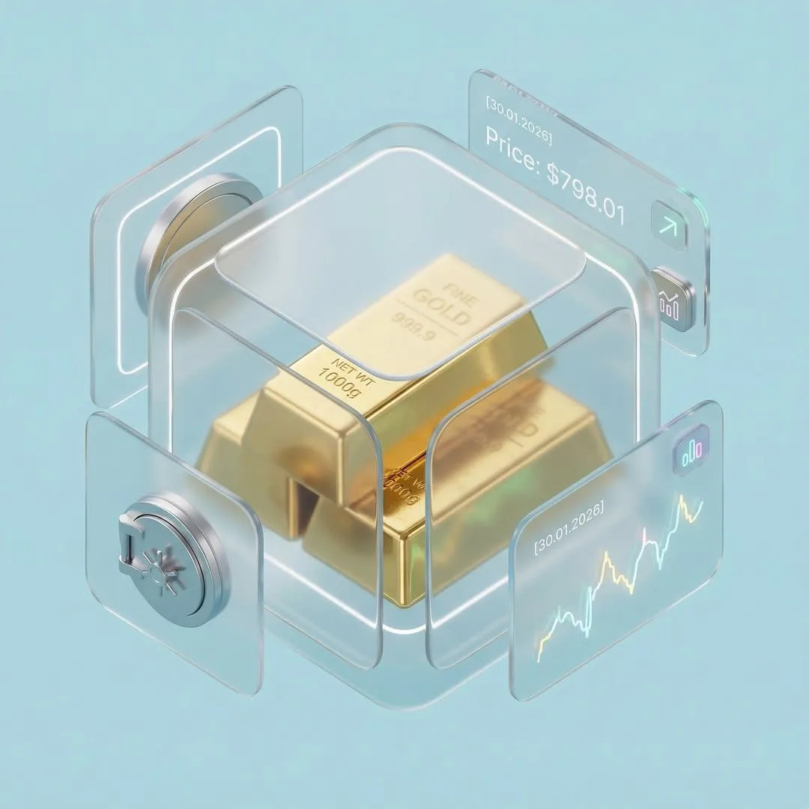

# Oogie — by @oggii_0

[← Back to Examples from X](../../EXAMPLES.md) · Category: Illustration & 3D · Model: `Nano Banana`

<a href="https://x.com/oggii_0/status/2017190570922582392"></a>

Original post: **[@oggii_0 on X](https://x.com/oggii_0/status/2017190570922582392)** · Creator: [Oogie](https://x.com/oggii_0)

## Prompt

```text
Refined 3D isometric composition (45° angle) in a Glassmorphism + Soft Claymorphism style.
The center of the composition features gold bars, rendered with hyper-realistic PBR materials, placed inside or surrounded by semi-transparent glass forms.

Visual Style Characteristics

Materials:
Primary focus on frosted glass with strong background blur. Element edges feature a subtle white inner glow, simulating polished glass bevels.

Layers:
A multi-layered composition where UI and graphic elements float at different transparency levels, creating a pronounced sense of depth.

Geometry:
Perfectly soft, rounded corners (Apple-style squircles).

Element Details

Central Object:
Highly detailed gold bars with precise engravings, realistically reflecting within surrounding glass surfaces.

Interface:
Floating panels with a frosted glass effect (40–60% opacity). Panels display clean sans-serif typography showing data for January 30, 2026: price, trend arrow, and a neon micro-chart.

Environment:
Stylized elements (vault door, market icons) crafted from a mix of polished metal and semi-transparent plastic.

Technical Parameters

Lighting:
Soft studio lighting, realistic caustics (light passing through glass), and global illumination (GI).

Background:
Solid powder blue color (#B0E0E6), providing contrast with translucent layers.

Render:
Cinema 4D, Octane Render, 8K resolution, ultra-high detail, clean minimalism.
```

## Try it

Paste the prompt into **[vinano.ai](https://vinano.ai?utm_source=github&utm_medium=readme&utm_campaign=awesome-image-video-prompts-updating&utm_content=x-page-try)** to generate your own version.

> The image and prompt belong to [@oggii_0](https://x.com/oggii_0) and are shown here with credit for reference. Creators can ask for changes or removal by opening an issue.
