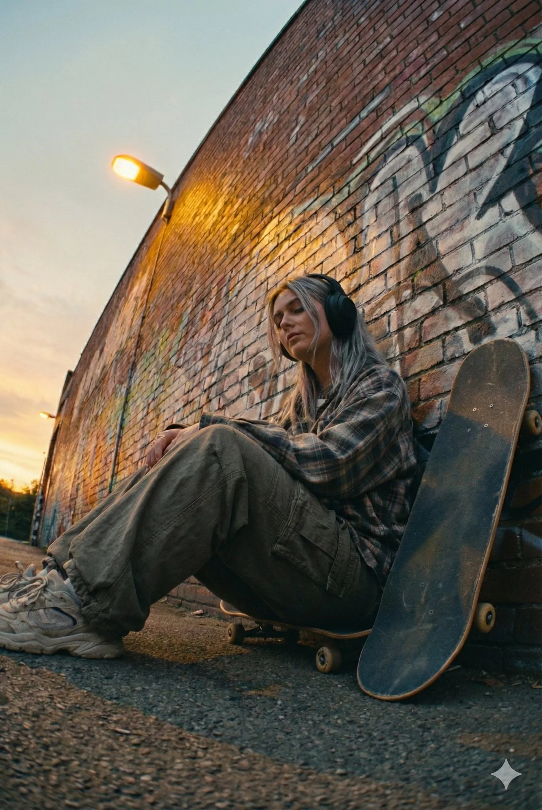

# Maercih — by @Maercihh

[← Back to Community Examples](../../EXAMPLES.md) · Category: Photography · Model: `Nano Banana`

<a href="https://x.com/Maercihh/status/2008456001503015309"></a>

Source: **[@Maercihh on X](https://x.com/Maercihh/status/2008456001503015309)** · Creator: [Maercih](https://x.com/Maercihh)

## Prompt

```text
{
  "model": "Nano Banana Pro",
  "scene": "Urban street corner at dusk beside a brick wall covered in graffiti",
  "subject": {
    "type": "Young woman",
    "pose": "Sitting on a skateboard with knees bent, back resting against a brick wall",
    "expression": "Calm, introspective, slightly distant",
    "gaze": "Eyes gently closed or lowered, absorbed in music",
    "emotion": "Stillness, reflection, quiet detachment"
  },
  "appearance": {
    "hair": {
      "color": "Silver-blonde",
      "style": "Loose, slightly tousled"
    },
    "accessories": "Over-ear black headphones",
    "skin": "Natural tone with soft evening light"
  },
  "attire": {
    "top": "Oversized plaid flannel shirt",
    "bottoms": "Loose cargo pants",
    "footwear": "Worn white sneakers",
    "style_note": "Relaxed streetwear, functional and unstyled"
  },
  "environment": {
    "location": "City alley or side street",
    "background": "Brick wall with faded graffiti art",
    "props": [
      "Skateboard leaning against the wall",
      "Street lamp mounted above"
    ],
    "atmosphere": "Urban, quiet, end-of-day calm"
  },
  "lighting": {
    "primary": "Warm street lamp light",
    "secondary": "Soft natural twilight",
    "effect": "Golden highlights on brick texture, gentle shadows"
  },
  "camera": {
    "angle": "Low-angle three-quarter view",
    "lens": "35mm cinematic lens",
    "depth_of_field": "Moderate, subject in focus with softly blurred background",
    "framing": "Vertical composition emphasizing street depth and wall lines"
  },
  "color_palette": {
    "dominant": ["warm brick red", "muted olive", "soft amber"],
    "accents": ["cool gray", "faded graffiti tones"]
  },
  "mood": "Urban, introspective, grounded",
  "style": {
    "aesthetic": "Cinematic street photography",
    "realism": "Photorealistic",
    "texture": "Rough brick, worn asphalt, fabric folds",
    "post_processing": "Warm highlights with slightly muted saturation"
  },
  "details": {
    "ground": "Rough asphalt with small debris",
    "board": "Scuffed skateboard deck showing use",
    "motion": "Still frame, no action or blur"
  },
  "themes": [
    "Urban solitude",
    "Music as escape",
    "Youth and pause",
    "Belonging without noise"
  ],
  "quality": "Ultra-detailed, high dynamic range, professional cinematic street portrait"
}
```

## Try it

Paste the prompt into **[vinano.ai](https://vinano.ai?utm_source=github&utm_medium=readme&utm_campaign=awesome-image-video-prompts-updating&utm_content=x-page-try)** to generate your own version.

> The image and prompt belong to @Maercihh ([original post](https://x.com/Maercihh/status/2008456001503015309)) and are shown here with credit for reference. Creators can ask for changes or removal by opening an issue.
