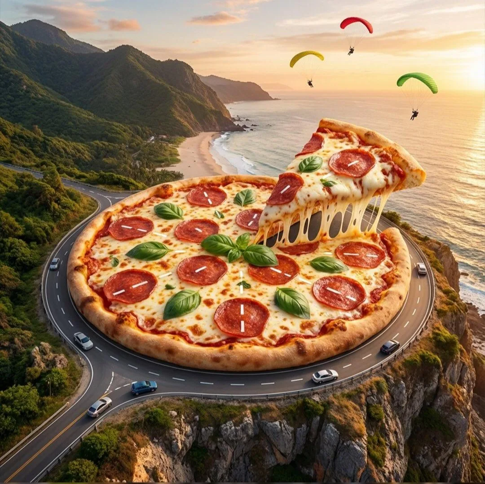

# Taaruk — by @Taaruk_

[← Back to Examples from X](../../EXAMPLES.md) · Category: Food & Drink · Model: `Nano Banana`

<a href="https://x.com/Taaruk_/status/2010350361144610992"></a>

Original post: **[@Taaruk_ on X](https://x.com/Taaruk_/status/2010350361144610992)** · Creator: [Taaruk](https://x.com/Taaruk_)

## Prompt

```text
{
  "Objective": "Create a surreal, hyper-detailed fantasy world where pizza becomes an integral part of landscapes and technology",
  "Concept": "Imaginative surrealism blending photorealistic food textures with cinematic fantasy environments",
  "Scenes": [
    {
      "SceneName": "Pizza Coastline Mountain Road",
      "SceneDescription": {
        "Environment": "Dramatic coastal cliffs overlooking the ocean",
        "PrimaryStructure": "A giant pepperoni pizza forming a winding mountain road",
        "WorldIntegration": {
          "Cheese": "Melted cheese forming the roadway surface",
          "Toppings": "Pepperoni slices and basil leaves acting as traffic islands and terrain features"
        },
        "ScaleElements": {
          "Vehicles": "Tiny cars driving across the pizza road",
          "ScaleContrast": "Massive pizza landscape versus miniature vehicles"
        }
      },
      "LightingAndMood": {
        "TimeOfDay": "Golden hour",
        "Lighting": "Warm coastal sunlight with long shadows",
        "Mood": "Whimsical, epic, playful wonder"
      },
      "Composition": {
        "Camera": "Cinematic wide-angle view",
        "Perspective": "Elevated, sweeping landscape shot",
        "DepthOfField": "Moderate depth with foreground and background clarity"
      }
    },
    {
      "SceneName": "Pizza Futuristic Car",
      "SceneDescription": {
        "Environment": "Rainy neon-lit cyberpunk city street at night",
        "PrimarySubject": "A pizza slice transformed into a futuristic car",
        "DesignDetails": {
          "Body": "Pizza crust and melted cheese forming aerodynamic shape",
          "Toppings": "Pepperoni and basil integrated into vehicle design",
          "Wheels": "Realistic rubber tires attached to the pizza vehicle"
        },
        "Motion": "Speeding through the street with dynamic motion blur"
      },
      "LightingAndMood": {
        "TimeOfDay": "Night",
        "Lighting": "Moody cyberpunk neon lights in red, teal, and magenta",
        "Atmosphere": "Rain, mist, reflections on wet asphalt",
        "Mood": "Energetic, futuristic, playful surrealism"
      },
      "Composition": {
        "Camera": "Low-angle wide shot",
        "Perspective": "Dynamic chase-style framing",
        "DepthOfField": "Shallow depth of field with background bokeh"
      }
    }
  ],
  "ArtDirection": {
    "Style": "Playful yet photorealistic surrealism",
    "TextureQuality": {
      "Food": "Ultra-realistic pizza textures, visible oil sheen, stretchy melted cheese",
      "Environment": "High-detail rocks, asphalt, rain droplets, reflections"
    },
    "RealismBalance": "Photorealistic materials combined with impossible scale and concepts"
  },
  "VisualStyle": {
    "Resolution": "8K ultra-high detail",
    "ColorGrading": "Cinematic contrast with warm coastal tones and cool neon city tones",
    "Depth": "Strong sense of scale and dimensionality"
  },
  "Mood": {
    "OverallTone": "Imaginative, whimsical, cinematic",
    "EmotionalFeel": "Playful awe and creative wonder"
  },
  "NegativePrompt": [
    "flat lighting",
    "cartoon-only style",
    "low detail textures",
    "plastic food",
    "blurry focus",
    "dull colors"
  ],
  "ResponseFormat": {
    "Type": "Two-scene cinematic illustration or render",
    "OutputOptions": [
      "Split composition",
      "Diptych",
      "Two separate images"
    ],
    "AspectRatio": "16:9"
  }
}
```

## Try it

Paste the prompt into **[vinano.ai](https://vinano.ai?utm_source=github&utm_medium=readme&utm_campaign=awesome-image-video-prompts-updating&utm_content=x-page-try)** to generate your own version.

> The image and prompt belong to [@Taaruk_](https://x.com/Taaruk_) and are shown here with credit for reference. Creators can ask for changes or removal by opening an issue.
