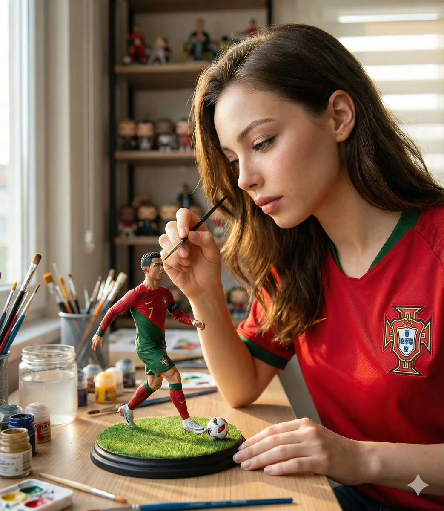

# Synthia — by @AIwithSynthia

[← Back to Community Examples](../../EXAMPLES.md) · Category: Photography · Model: `Nano Banana`

<a href="https://x.com/AIwithSynthia/status/2011329615814607139"></a>

Source: **[@AIwithSynthia on X](https://x.com/AIwithSynthia/status/2011329615814607139)** · Creator: [Synthia](https://x.com/AIwithSynthia)

## Prompt

```text
A hyper-realistic cinematic scene of a woman carefully painting a miniature football figurine of Cristiano Ronaldo in a Portugal national team jersey. The tiny footballer is frozen mid-dribble with the ball at his feet, standing on a round grass base placed on a wooden desk. The woman wears a matching red Portugal jersey and focuses intently while holding a fine paintbrush near the figure’s face. Soft natural window light creates warm highlights and gentle shadows, shallow depth of field with a blurred shelf of collectibles in the background. Ultra-detailed textures on fabric, skin, and paint strokes, photorealistic scale illusion, cinematic storytelling composition, premium studio realism, 50mm lens look, high-end editorial mood
```

## Try it

Paste the prompt into **[vinano.ai](https://vinano.ai?utm_source=github&utm_medium=readme&utm_campaign=awesome-image-video-prompts-updating&utm_content=x-page-try)** to generate your own version.

> The image and prompt belong to @AIwithSynthia ([original post](https://x.com/AIwithSynthia/status/2011329615814607139)) and are shown here with credit for reference. Creators can ask for changes or removal by opening an issue.
