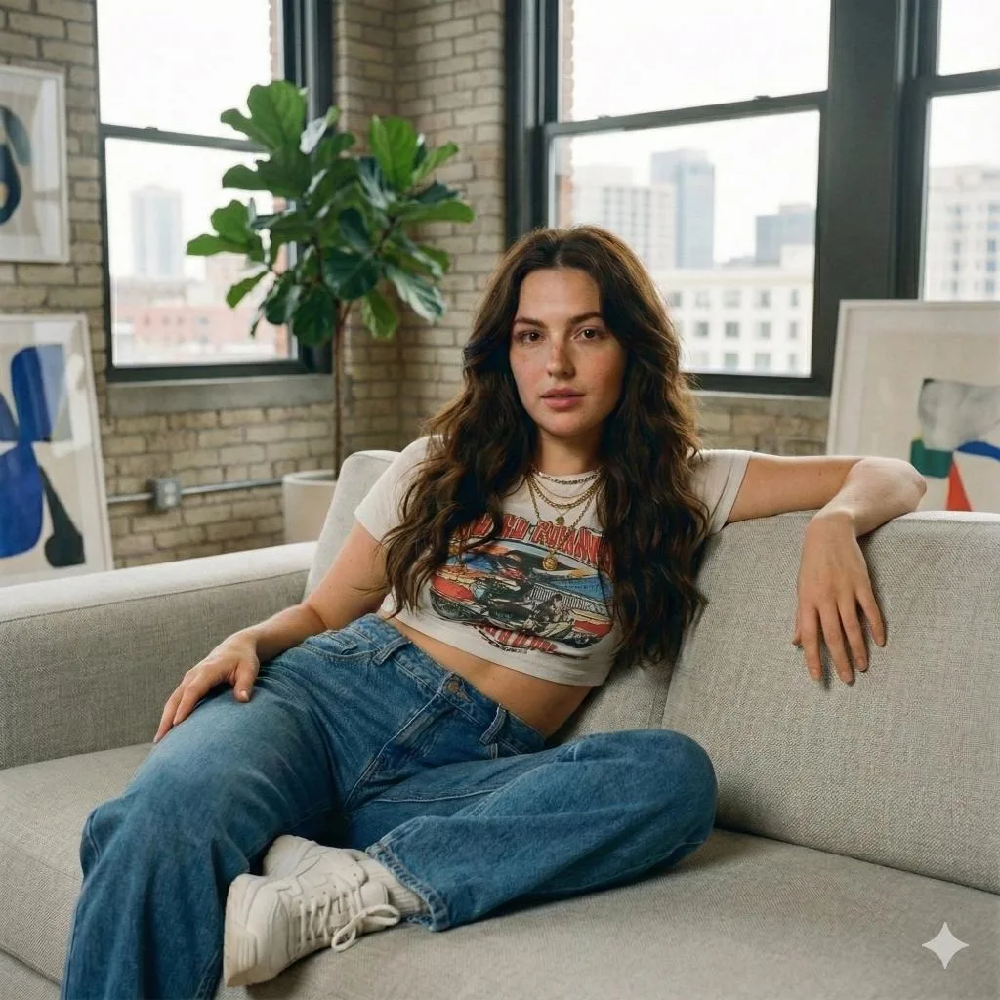

# Maercih — by @Maercihh

[← Back to Examples from X](../../EXAMPLES.md) · Category: Photography · Model: `Nano Banana`

<a href="https://x.com/Maercihh/status/2009487340285440312"></a>

Original post: **[@Maercihh on X](https://x.com/Maercihh/status/2009487340285440312)** · Creator: [Maercih](https://x.com/Maercihh)

## Prompt

```text
{
  "model": "Nano Banana Pro",
  "scene": "Modern loft living room with large industrial windows",
  "subject": {
    "type": "Young woman",
    "pose": "Reclining casually on a fabric sofa, one arm resting along the backrest, legs relaxed",
    "expression": "Calm, self-assured, quietly confident",
    "gaze": "Direct eye contact with the camera",
    "emotion": "Ease, confidence, natural presence"
  },
  "appearance": {
    "hair": {
      "color": "Dark brown",
      "style": "Loose, long waves with natural volume"
    },
    "skin": "Natural complexion with subtle freckles and realistic texture",
    "makeup": "Minimal, clean, natural tones"
  },
  "attire": {
    "top": "Vintage-style cropped graphic t-shirt",
    "bottoms": "High-waisted relaxed-fit blue jeans",
    "footwear": "White casual sneakers",
    "accessories": [
      "Layered gold necklaces"
    ],
    "style_note": "Effortless modern street-lifestyle fashion"
  },
  "environment": {
    "location": "Urban loft apartment",
    "background": [
      "Exposed brick walls",
      "Large black-framed windows",
      "City skyline softly visible outside",
      "Indoor potted plant",
      "Abstract framed artwork leaning against walls"
    ],
    "atmosphere": "Airy, contemporary, lived-in"
  },
  "lighting": {
    "primary": "Soft natural daylight from large windows",
    "effect": "Balanced illumination with gentle facial shadows",
    "contrast": "Low to moderate, natural realism"
  },
  "camera": {
    "angle": "Eye-level lifestyle portrait",
    "lens": "35mm lifestyle lens",
    "depth_of_field": "Moderate, subject in focus with softly blurred background",
    "framing": "Horizontal composition, relaxed editorial framing"
  },
  "color_palette": {
    "dominant": ["neutral beige", "denim blue"],
    "accents": ["warm skin tones", "muted green", "soft brick red"]
  },
  "mood": "Relaxed, confident, contemporary",
  "style": {
    "aesthetic": "Lifestyle editorial photography",
    "realism": "Photorealistic",
    "texture": "Visible denim grain, fabric upholstery detail",
    "post_processing": "Natural color grading, subtle warmth, no heavy filters"
  },
  "details": {
    "sofa": "Light neutral fabric couch with soft texture",
    "windows": "Tall industrial-style windows with diffused city light",
    "motion": "Still, candid moment"
  },
  "themes": [
    "Modern femininity",
    "Comfort and confidence",
    "Everyday luxury",
    "Authentic presence"
  ],
  "quality": "Ultra-detailed, high dynamic range, professional lifestyle photography"
}
```

## Try it

Paste the prompt into **[vinano.ai](https://vinano.ai?utm_source=github&utm_medium=readme&utm_campaign=awesome-image-video-prompts-updating&utm_content=x-page-try)** to generate your own version.

> The image and prompt belong to [@Maercihh](https://x.com/Maercihh) and are shown here with credit for reference. Creators can ask for changes or removal by opening an issue.
