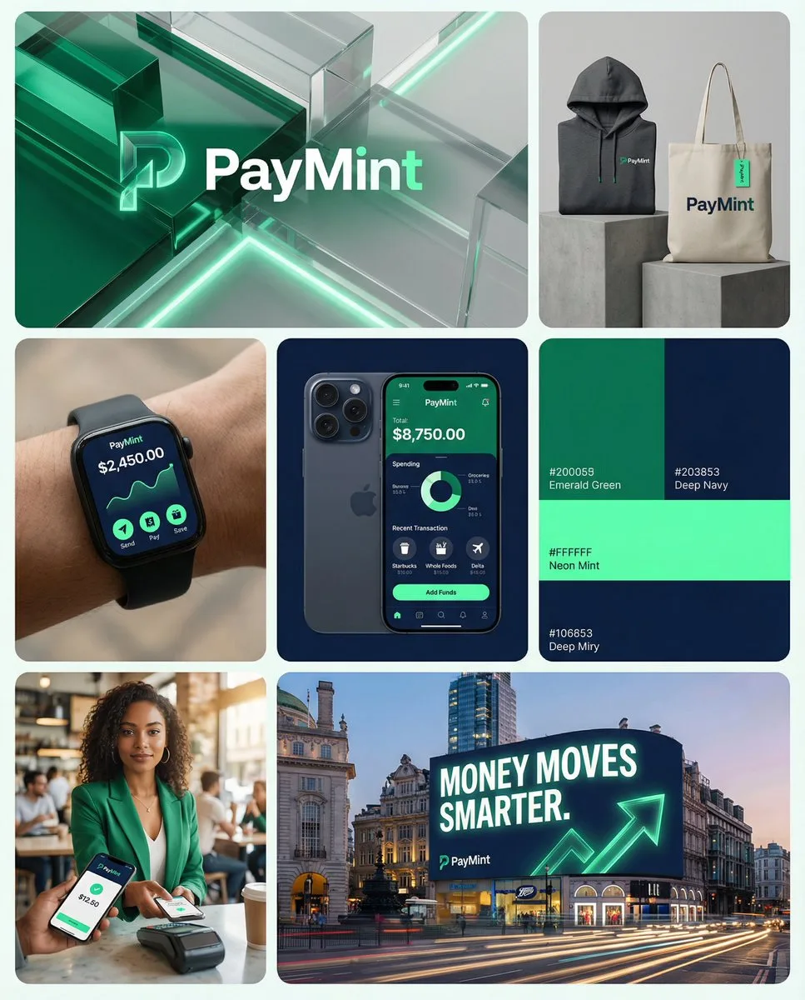

# Ege — by @egeberkina

[← Back to Examples from X](../../EXAMPLES.md) · Category: Product & Brand · Model: `Nano Banana`

<a href="https://x.com/egeberkina/status/2032185087534477643"></a>

Original post: **[@egeberkina on X](https://x.com/egeberkina/status/2032185087534477643)** · Creator: [Ege](https://x.com/egeberkina)

## Prompt

```text
You are a world class creative director, brand strategist, editorial art director, and visual identity designer specializing in high impact campaign systems for global fintech and technology brands.

Your task is to create a bold, intelligent, visually striking campaign board that feels like a professional brand identity presentation for a modern fintech startup.

Create a campaign layout composed of multiple tiles arranged in a dynamic brand grid layout (not a strict 3x3 grid).

LAYOUT STRUCTURE:

Top Row
• one wide landscape hero tile
• one square tile

Middle Row
• three square tiles

Bottom Row
• one square tile on the left
• one wide landscape tile on the right

Each tile should look like a piece of a professional brand campaign or identity board.

BRAND NAME: [INSERT BRAND NAME]

PRIMARY BRAND COLOR: [INSERT COLOR]

SECONDARY BRAND COLOR: [INSERT COLOR]

ACCENT COLOR: [INSERT COLOR]

APP NAME: [INSERT APP NAME]

OPTIONAL SLOGAN: [INSERT SLOGAN]

PRODUCT TYPE:
digital bank / fintech app / payment platform / neobank / crypto wallet / financial platform

VISUAL STYLE:

Modern fintech brand campaign mixing:

• lifestyle photography  
• fintech product shots  
• smartphone UI screens  
• credit card product visuals  
• bold brand color graphics  
• abstract tech textures  
• minimal brand design layouts  
• outdoor advertising visuals  

The aesthetic should feel like a hybrid between:

Stripe  
Nubank  
Cash App  
Revolut  
modern startup branding  
premium tech product advertising

ART DIRECTION:

The grid should combine multiple brand communication assets such as:

• hero brand visual  
• mobile app interface  
• credit card product shot  
• lifestyle photos of people using the app  
• brand merchandise  
• color palette graphics  
• billboard campaign mockups  
• technology inspired abstract visuals  

Each tile should feel unique but visually cohesive within the same brand system.

TILE IDEAS:

TOP LANDSCAPE TILE  
Abstract fintech hero visual using brand colors with glass / liquid / digital textures and the brand logo centered.

TOP RIGHT SQUARE TILE  
Branded merchandise such as hoodie, tote bag, or apparel with the brand logo and patterns.

MIDDLE LEFT TILE  
Smartwatch or smartphone displaying the fintech app UI.

MIDDLE CENTER TILE  
Close-up iPhone screen showing the fintech app dashboard.

MIDDLE RIGHT TILE  
Brand color palette tile showing the official colors and minimal identity elements.

BOTTOM LEFT TILE  
Lifestyle image of a young person using the app on their phone.

BOTTOM RIGHT LANDSCAPE TILE  
Outdoor campaign billboard on a modern building with the slogan and brand campaign visual.

VISUAL CHARACTERISTICS:

• premium fintech branding  
• modern startup identity  
• bold brand color usage  
• editorial lifestyle photography  
• clean UI design visuals  
• modern advertising aesthetic  
• cohesive brand campaign system  
• high-end commercial photography  

IMPORTANT:

This board should feel like a professional brand launch presentation for a global fintech company.

Each tile should look like a different campaign asset but visually belong to the same brand identity system.

AI GENERATION NOTES:

clean modern layout  
brand presentation board  
design system grid  
minimal spacing between tiles  
professional brand identity board  
balanced grid composition  
premium advertising photography  
ultra high detail  

visualized as a modern startup brand identity board similar to a design presentation on Behance or Dribbble, cohesive campaign layout
```

## Try it

Paste the prompt into **[vinano.ai](https://vinano.ai?utm_source=github&utm_medium=readme&utm_campaign=awesome-image-video-prompts-updating&utm_content=x-page-try)** to generate your own version.

> The image and prompt belong to [@egeberkina](https://x.com/egeberkina) and are shown here with credit for reference. Creators can ask for changes or removal by opening an issue.
