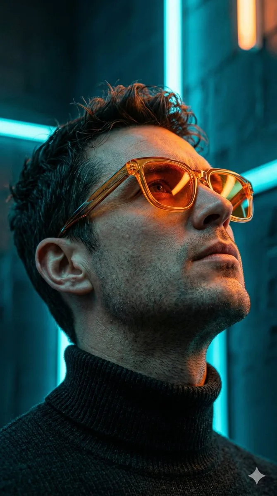

# Gopal Tiwari — by @imGopalTiwari

[← Back to Examples from X](../../EXAMPLES.md) · Category: Photography · Model: `Nano Banana`

<a href="https://x.com/imGopalTiwari/status/2041000388133106148"></a>

Original post: **[@imGopalTiwari on X](https://x.com/imGopalTiwari/status/2041000388133106148)** · Creator: [Gopal Tiwari](https://x.com/imGopalTiwari)

## Prompt

```text
A man, likely in his early thirties with facial proportions, structure, and overall appearance inspired by the reference, captured in full sharp detail and natural skin texture,
hyper-detailed, cinematic close-up profile portrait, vertical orientation, extreme low-angle (worm's-eye view), focusing on the face from the neck up. The man gazes upward with a serious, intense expression. He has dark, short, slightly tousled hair, catching subtle highlights. His facial features are sharply defined, with a strong jawline and natural stubble. Skin texture is realistic, showing pores, subtle imperfections, and natural subsurface scattering.
Clothing & Accessories:
He wears a high-collared, dark turtleneck that absorbs light, creating a strong contrast against the illuminated face. He has large, round, retro-futuristic sunglasses with thick, transparent or light-colored frames and intensely bright orange lenses. The sunglasses reflect the ambient and primary lighting naturally.
Lighting & Color:
Extreme, high-contrast neon lighting with complementary color scheme. Primary light is intense, warm orange/amber emanating from the sunglasses direction, illuminating the nose bridge, cheekbones, and frame edges. Secondary ambient light is cool cyan-blue, providing deep backlight and shadow fill. Shadows are deep indigo and ultramarine, producing strong chiaroscuro, with the subject’s face partially obscured by cool shadows but punctuated with warm orange highlights. Volumetric light subtly interacts with hair and glasses for realism.
Composition & Perspective:
Low-angle close-up emphasizing upward gaze, strong jawline, and facial structure. Solid cyan-blue background ensures the subject stands out, with clean composition and dramatic silhouette. Shallow depth of field isolates the face and sunglasses.
Artistic Style & Mood:
Hyper-realistic, cinematic, photorealistic editorial portrait with cyberpunk, neo-noir, and 80s synthwave aesthetic. Mood is intense, mysterious, and high-fashion.
Technical Details:
Ultra-high resolution, 8K, sharp focus on facial features and sunglasses, realistic skin rendering with NanoBanana Pro quality, natural subsurface scattering, realistic fabric texture, volumetric and rim lighting, cinematic color grading.
Negative Prompts:
cartoon, painting, sketch, 3D render, CGI, plastic skin, blurry, low quality, feminine traits, excessive makeup, watermark, text, unrealistic exaggeration.
```

## Try it

Paste the prompt into **[vinano.ai](https://vinano.ai?utm_source=github&utm_medium=readme&utm_campaign=awesome-image-video-prompts-updating&utm_content=x-page-try)** to generate your own version.

> The image and prompt belong to [@imGopalTiwari](https://x.com/imGopalTiwari) and are shown here with credit for reference. Creators can ask for changes or removal by opening an issue.
