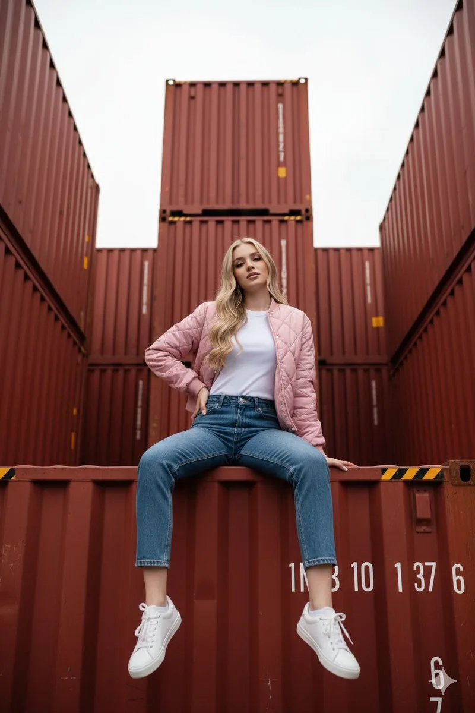

# The Newz 2.0 — by @TheNewz_816

[← Back to Community Examples](../../EXAMPLES.md) · Category: Photography · Model: `Nano Banana`

<a href="https://x.com/TheNewz_816/status/2011379631740633191"></a>

Source: **[@TheNewz_816 on X](https://x.com/TheNewz_816/status/2011379631740633191)** · Creator: [The Newz 2.0](https://x.com/TheNewz_816)

## Prompt

```text
Use the same face from the reference image without changing facial features 

{
  "image_description": "A high-angle, low-perspective full-body portrait of a young western woman with blonde hair sitting on the edge of a red industrial shipping container.",
  "subject": {
    "person": "Young western woman, fit build, serious expression, looking away from the camera toward the horizon.",
    "hair_style": "long blonde",
    "clothing": {
      "jacket": "Light grey quilted puffer bomber jacket with a diamond pattern.",
      "undershirt": "Plain crisp white crew-neck t-shirt.",
      "pants": "Classic medium-wash blue denim jeans, straight fit.",
      "footwear": "Clean, bright white leather low-top sneakers."
    },
    "pose": "Sitting relaxed on the edge of a metal container, legs dangling, leaning slightly back on his right hand."
  },
  "setting": {
    "location": "Industrial shipping yard or port.",
    "background_elements": [
      "Stacked corrugated red metal shipping containers.",
      "A vertical red container behind the subject creates a strong leading line.",
      "Yellow stencil lettering visible on the container beneath the subject."
    ],
    "atmosphere": "Urban, gritty yet clean, modern streetwear aesthetic."
  },
  "composition_and_lighting": {
    "camera_angle": "Low angle looking up, creating a sense of scale and height.",
    "lighting": "Natural, diffused daylight; soft shadows; overcast sky providing even illumination.",
    "color_palette": [
      "Primary: Bold industrial red",
      "Secondary: Denim blue, light grey, and crisp white",
      "Background: Muted grey/white sky"
    ],
    "lens_effects": "Deep depth of field with sharp focus on the subject and the immediate container texture."
  },
  "technical_tags": "Street photography, architectural lines, hyper-realistic, 8k resolution, cinematic lighting, industrial fashion shoot."
}
```

## Try it

Paste the prompt into **[vinano.ai](https://vinano.ai?utm_source=github&utm_medium=readme&utm_campaign=awesome-image-video-prompts-updating&utm_content=x-page-try)** to generate your own version.

> The image and prompt belong to @TheNewz_816 ([original post](https://x.com/TheNewz_816/status/2011379631740633191)) and are shown here with credit for reference. Creators can ask for changes or removal by opening an issue.
