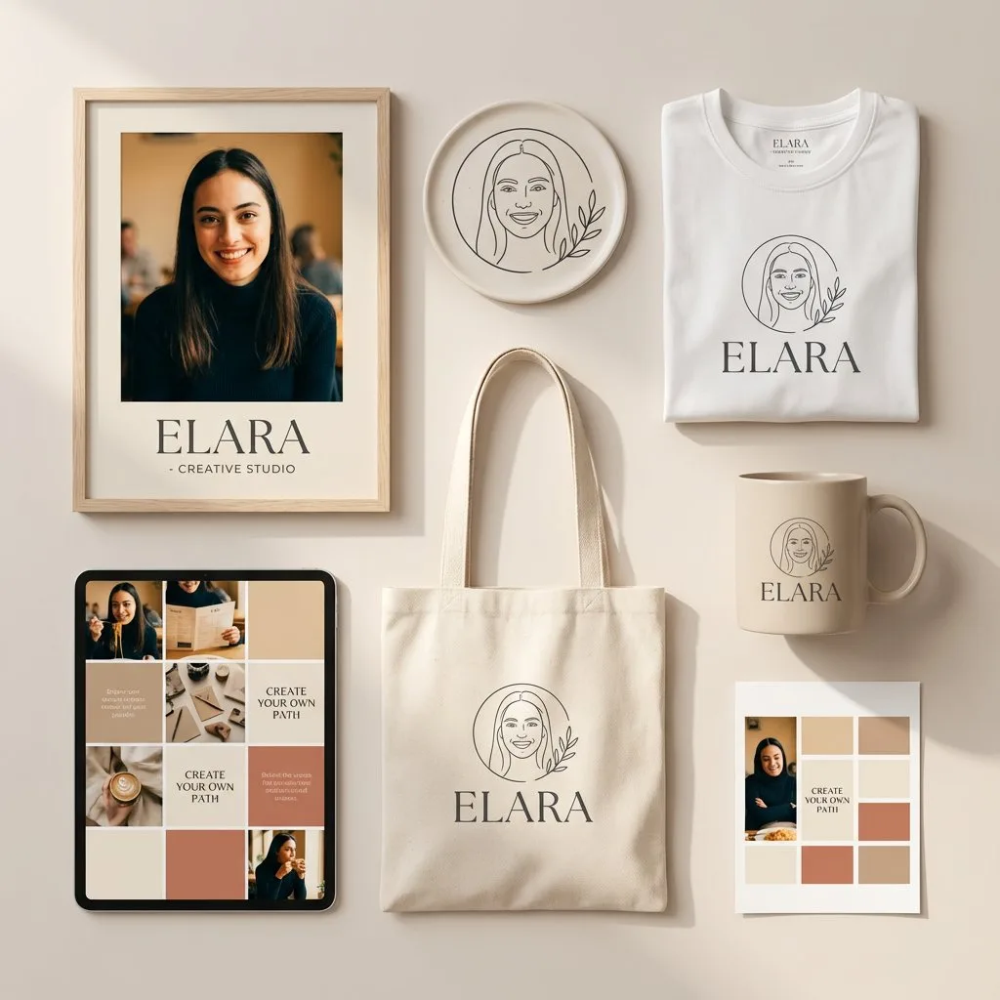

# Synthia — by @AIwithSynthia

[← Back to Community Examples](../../EXAMPLES.md) · Category: Product & Brand · Model: `Nano Banana`

<a href="https://x.com/AIwithSynthia/status/2009592182630744078"></a>

Source: **[@AIwithSynthia on X](https://x.com/AIwithSynthia/status/2009592182630744078)** · Creator: [Synthia](https://x.com/AIwithSynthia)

## Prompt

```text
A clean, modern personal branding mockup featuring a cohesive visual identity for a female creator or entrepreneur. The scene includes a minimalist brand kit displayed on a soft neutral background: a framed portrait with elegant typography, a circular logo with a hand-drawn line-art face illustration, and branded merchandise such as a white t-shirt, tote bag, and ceramic mug printed with the same logo. A grid-style social media layout showcases portrait photography, behind-the-scenes content, quotes, and solid color brand tiles in warm beige, cream, and muted terracotta tones. Google Gemini The overall aesthetic is creative, modern, and minimal, with soft natural lighting, premium lifestyle photography, balanced composition, Scandinavian-inspired design, high-end branding presentation, editorial feel, and consistent typography. Ideal for a personal brand, content creator, or lifestyle entrepreneur identity showcase.
```

## Try it

Paste the prompt into **[vinano.ai](https://vinano.ai?utm_source=github&utm_medium=readme&utm_campaign=awesome-image-video-prompts-updating&utm_content=x-page-try)** to generate your own version.

> The image and prompt belong to @AIwithSynthia ([original post](https://x.com/AIwithSynthia/status/2009592182630744078)) and are shown here with credit for reference. Creators can ask for changes or removal by opening an issue.
