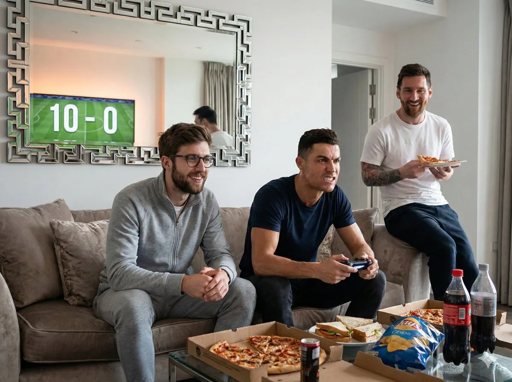

# Duet | AI — by @Sheldon056

[← Back to Community Examples](../../EXAMPLES.md) · Category: Photography · Model: `Nano Banana`

<a href="https://x.com/Sheldon056/status/2011398486152061051"></a>

Source: **[@Sheldon056 on X](https://x.com/Sheldon056/status/2011398486152061051)** · Creator: [Duet | AI](https://x.com/Sheldon056)

## Prompt

```text
A hyper-realistic, ultra-detailed 8K cinematic photograph captured with a 35mm lens, medium-wide shot, set inside a realistic, modern apartment living room with a natural, lived-in home atmosphere.

Scene logic & composition:
The TV is positioned directly in front of the players and remains outside the camera frame.
A large decorative mirror on the wall subtly reflects the TV screen, clearly showing the final match result.

In the mirror reflection, the football video game result screen displays a crushing score: 10 – 0, clearly in favor of the main subject.
The numbers are bold, bright, and unmistakable against a green pitch and stadium crowd background.

In the foreground, the main subject (uploaded 100% face as reference, identity fully locked and preserved) is seated on a comfortable couch, body oriented straight toward the unseen TV. He is wearing a relaxed home tracksuit , calm and confident, with a controlled victorious expression after the dominant win.

Seated next to him on the couch is Cristiano Ronaldo, holding a PlayStation controller tightly.
His body language shows clear frustration and anger: tense jaw, furrowed brows, clenched fists, shoulders tight, leaning forward aggressively.
His expression communicates competitive rage and disbelief after losing so badly.

Standing slightly behind and to the side of the couch is Lionel Messi, relaxed and casual, eating food from a plate while watching the scene.
He is smiling subtly, enjoying the moment, completely calm and unbothered, creating a strong contrast with Ronaldo’s anger and adding humor and human warmth to the scene.

A realistic coffee table sits between the couch and the TV, filled with casual home snacks and drinks: pizza slices, chips, sandwiches, and soft drinks, slightly messy to enhance realism.

Lighting is soft, cinematic, and natural, combining ambient room light with the reflected TV glow from the mirror, which subtly illuminates faces and hands.
Depth of field keeps the faces and mirror reflection sharp while softly blurring background elements.

Ultra-realistic skin texture, natural fabric wrinkles, realistic controller reflections, subtle dust particles in the air.
Photorealistic, candid, unstaged moment.
A perfect balance of tension, humor, and realism
```

## Try it

Paste the prompt into **[vinano.ai](https://vinano.ai?utm_source=github&utm_medium=readme&utm_campaign=awesome-image-video-prompts-updating&utm_content=x-page-try)** to generate your own version.

> The image and prompt belong to @Sheldon056 ([original post](https://x.com/Sheldon056/status/2011398486152061051)) and are shown here with credit for reference. Creators can ask for changes or removal by opening an issue.
