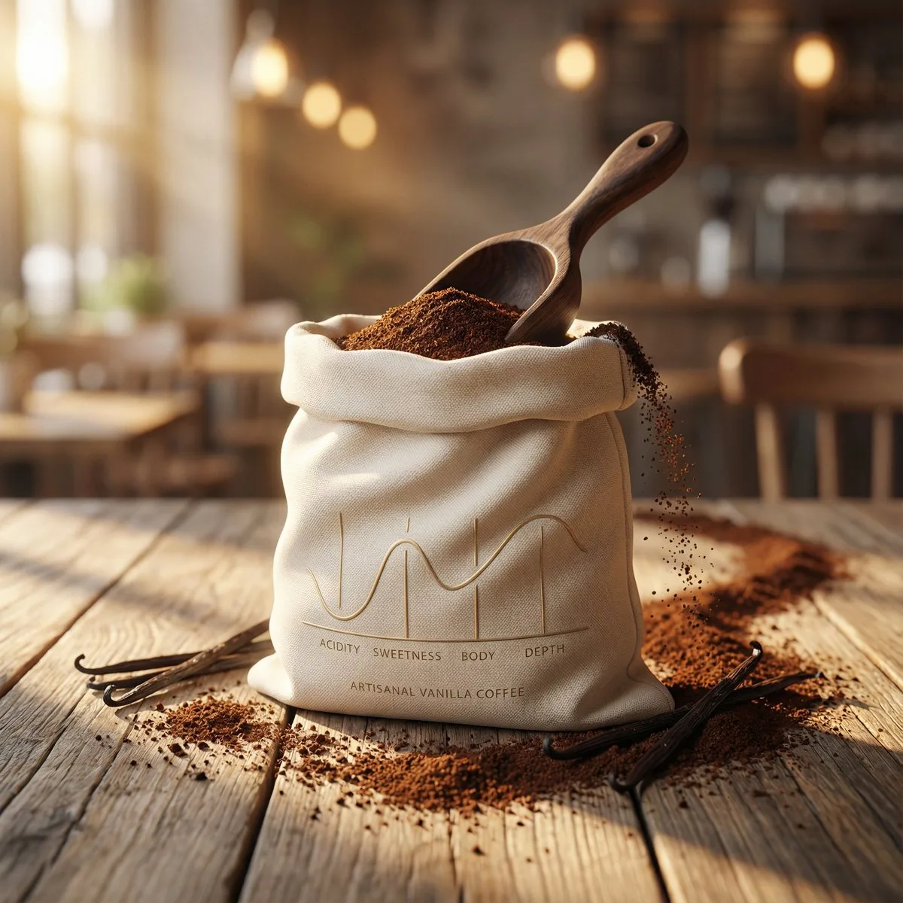

# Sharon Riley — by @Just_sharon7

[← Back to Examples from X](../../EXAMPLES.md) · Category: Illustration & 3D · Model: `Nano Banana`

<a href="https://x.com/Just_sharon7/status/2012110717592457678"></a>

Original post: **[@Just_sharon7 on X](https://x.com/Just_sharon7/status/2012110717592457678)** · Creator: [Sharon Riley](https://x.com/Just_sharon7)

## Prompt

```text
Luxury product photography of artisanal vanilla ground coffee packaged in a soft sculpted ivory pouch with gentle wave contours, minimal branding embossed into fabric. The pouch rests on a rustic oak tabletop dusted with coffee grounds, accompanied by a hand-carved wooden scoop spilling aromatic powder.
Natural Madagascar vanilla pods curve organically around the base, blending into drifting coffee granules that form a subtle flowing aroma path instead of a spiral.
On the pouch front, a modern sensory chart: thin matte gold lines showing flavor balance — low acidity, rich sweetness, full-bodied depth.
Warm morning sunlight enters from the left at a low angle, creating soft shadows and tactile fabric highlights. Background fades into a cozy café interior with creamy bokeh lights, evoking calm morning rituals.
Ultra-sharp macro texture on vanilla pods and coffee grains, cinematic depth of field, premium lifestyle aesthetic, inviting, warm, handcrafted, high-end brand feel.
```

## Try it

Paste the prompt into **[vinano.ai](https://vinano.ai?utm_source=github&utm_medium=readme&utm_campaign=awesome-image-video-prompts-updating&utm_content=x-page-try)** to generate your own version.

> The image and prompt belong to [@Just_sharon7](https://x.com/Just_sharon7) and are shown here with credit for reference. Creators can ask for changes or removal by opening an issue.
