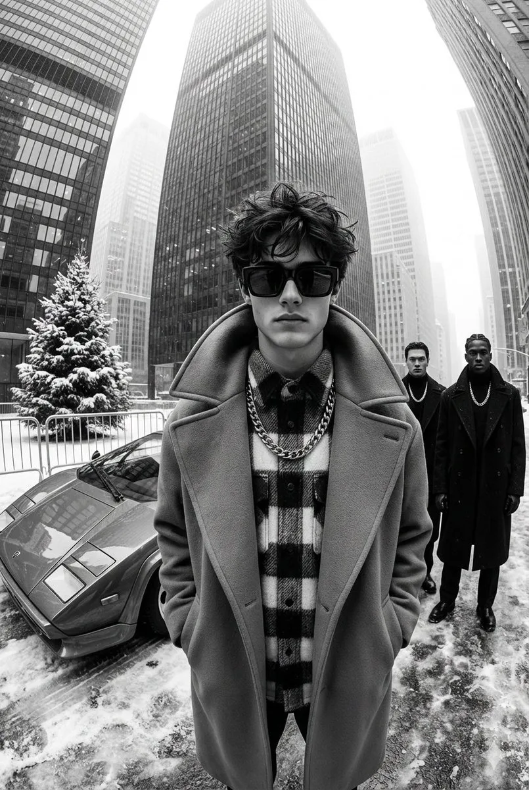

# Harboriis — by @harboriis

[← Back to Community Examples](../../EXAMPLES.md) · Category: Photography · Model: `Nano Banana`

<a href="https://x.com/harboriis/status/2012005508769857710"></a>

Source: **[@harboriis on X](https://x.com/harboriis/status/2012005508769857710)** · Creator: [Harboriis](https://x.com/harboriis)

## Prompt

```text
A black-and-white, high-contrast, ultra-glamorous street fashion editorial photograph taken with an ultra-wide-angle lens that creates the effect of a slight perspective deformation. A vertical composition in the center of a large urban space surrounded by high-rise buildings that rise up and converge to the center of the frame, forming a dramatic architectural geometry. It's a winter day, there is an uneven layer of snow and ice on the ground, the surface is matte, with the texture of frozen asphalt. The contrast is soft at the top of the frame due to the atmospheric haze. In the foreground is the young man standing closest to the camera. He's wearing large rectangular dark sunglasses. Hairstyle-short, with dense front

styling, partially disheveled, slight asymmetry of strands. The emotion is neutral, serious, and the gaze is directed directly into the lens. He is wearing a voluminous long coat with a massive collar, under which multi-layered clothes are visible, including a thick shirt with a pronounced checkered texture. A large heavy chain with massive links hangs on the chest, visually dominating the composition. Behind, to the left and right of the man, there are two men dressed identically in dark ensembles: thick coats or jackets, smooth fabrics that emphasize a strict silhouette. They wear large chains of a similar type, stacked on top of clothes. They wear dark sunglasses. They stand statically, strictly, with their legs slightly apart, arms lowered or gathered in front of them. Their figures create balance on the sides of the frame. On the left behind there is a sports car with a low wide body and a pronounced wedge-shaped front. The polished metal reflects the

surrounding buildings and the sky. The car is parked on a snow-covered surface next to a small city Christmas tree, surrounded by metal fences..

The fir tree is fluffy and rich in tone, contrasting with the smooth surfaces of cars and skyscrapers. The urban backdrop consists of densely packed skyscrapers stretching into the misty sky. Their glass and concrete facades create vertical rhythms. The light is diffused, wintry, soft, without pronounced shadows. The color scheme is a pure monochrome palette with deep shadows and even light areas. The processing is glossy, with a light feel of an advertising photo shoot, moderate grain, high sharpness in the foreground.
```

## Try it

Paste the prompt into **[vinano.ai](https://vinano.ai?utm_source=github&utm_medium=readme&utm_campaign=awesome-image-video-prompts-updating&utm_content=x-page-try)** to generate your own version.

> The image and prompt belong to @harboriis ([original post](https://x.com/harboriis/status/2012005508769857710)) and are shown here with credit for reference. Creators can ask for changes or removal by opening an issue.
