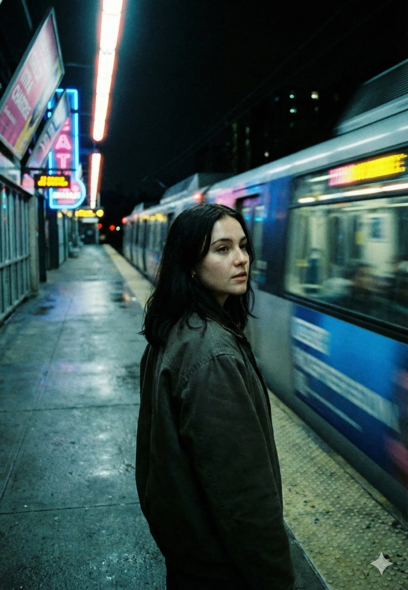

# Maercih — by @Maercihh

[← Back to Examples from X](../../EXAMPLES.md) · Category: Photography · Model: `Nano Banana`

<a href="https://x.com/Maercihh/status/2009944367377653780"></a>

Original post: **[@Maercihh on X](https://x.com/Maercihh/status/2009944367377653780)** · Creator: [Maercih](https://x.com/Maercihh)

## Prompt

```text
{
  "model": "Nano Banana Pro",
  "scene": "Underground metro platform at night with a train rushing past",
  "subject": {
    "type": "Young woman",
    "pose": "Standing near the platform edge, body facing forward, head turned slightly toward the camera",
    "expression": "Thoughtful, distant, quietly alert",
    "gaze": "Looking sideways toward the camera, unfixed, introspective",
    "emotion": "Isolation, reflection, restrained tension"
  },
  "appearance": {
    "hair": {
      "color": "Dark brown to black",
      "style": "Loose, straight, natural fall"
    },
    "skin": "Natural complexion with soft shadows",
    "makeup": "Minimal, realistic, understated"
  },
  "attire": {
    "outerwear": "Oversized dark jacket",
    "style_note": "Functional, muted, urban anonymity"
  },
  "environment": {
    "location": "City subway platform",
    "background_elements": [
      "Blurred metro train in motion",
      "Neon signage",
      "Platform lights",
      "Wet reflective floor surface",
      "Metal railings and tiled platform edge"
    ],
    "atmosphere": "Cold, nocturnal, transient"
  },
  "lighting": {
    "primary": "Artificial fluorescent platform lighting",
    "secondary": "Neon signage glow",
    "effect": "Cool-toned highlights with soft facial shadows"
  },
  "camera": {
    "angle": "Eye-level, slightly behind the subject",
    "lens": "35mm cinematic street lens",
    "shutter_effect": "Motion blur on passing train",
    "depth_of_field": "Moderate, subject sharp with moving background blur",
    "framing": "Vertical, cinematic street composition"
  },
  "color_palette": {
    "dominant": ["teal", "cool blue", "deep black"],
    "accents": ["neon pink", "electric yellow"]
  },
  "mood": "Lonely, cinematic, suspended in time",
  "style": {
    "aesthetic": "Neo-noir street photography",
    "realism": "Photorealistic",
    "inspiration": "Urban cinema, night transit, modern solitude",
    "post_processing": "Cool cinematic grading, slight grain, high contrast shadows"
  },
  "details": {
    "motion_contrast": "Still subject against fast-moving train",
    "floor_reflections": "Wet surface reflecting neon lights",
    "sound_implied": "Rushing train, distant city hum"
  },
  "themes": [
    "Urban loneliness",
    "Waiting",
    "Movement vs stillness",
    "Anonymous city life"
  ],
  "quality": "Ultra-detailed, cinematic night street photograph with motion depth"
}
```

## Try it

Paste the prompt into **[vinano.ai](https://vinano.ai?utm_source=github&utm_medium=readme&utm_campaign=awesome-image-video-prompts-updating&utm_content=x-page-try)** to generate your own version.

> The image and prompt belong to [@Maercihh](https://x.com/Maercihh) and are shown here with credit for reference. Creators can ask for changes or removal by opening an issue.
