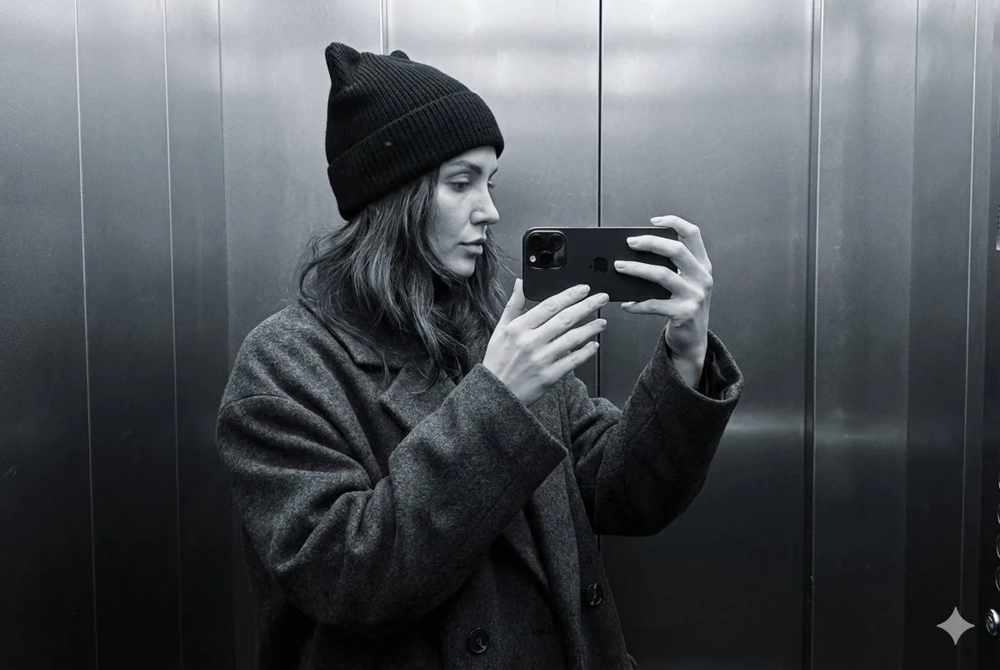

# Harboriis — by @harboriis

[← Back to Examples from X](../../EXAMPLES.md) · Category: Photography · Model: `Nano Banana`

<a href="https://x.com/harboriis/status/2016383627076989240"></a>

Original post: **[@harboriis on X](https://x.com/harboriis/status/2016383627076989240)** · Creator: [Harboriis](https://x.com/harboriis)

## Prompt

```text
A photorealistic profile selfie, minimalist and monochrome: a woman in a dark oversized coat and a black knit hat with cat ears, her hair falling loosely down her back; she holds a black iPhone 17 Pro Max smartphone, taking a picture of herself in an elevator mirror with a matte metal surface in the background. Soft diffused lighting, calm cool color scheme (black, graphite, gray steel), slight film grain, shallow depth of field on the phone and hands, highly detailed fabric and hair textures, 3:2 vertical composition, realistic style, 4K, natural light, soft shadows, moody aesthetic.
```

## Try it

Paste the prompt into **[vinano.ai](https://vinano.ai?utm_source=github&utm_medium=readme&utm_campaign=awesome-image-video-prompts-updating&utm_content=x-page-try)** to generate your own version.

> The image and prompt belong to [@harboriis](https://x.com/harboriis) and are shown here with credit for reference. Creators can ask for changes or removal by opening an issue.
