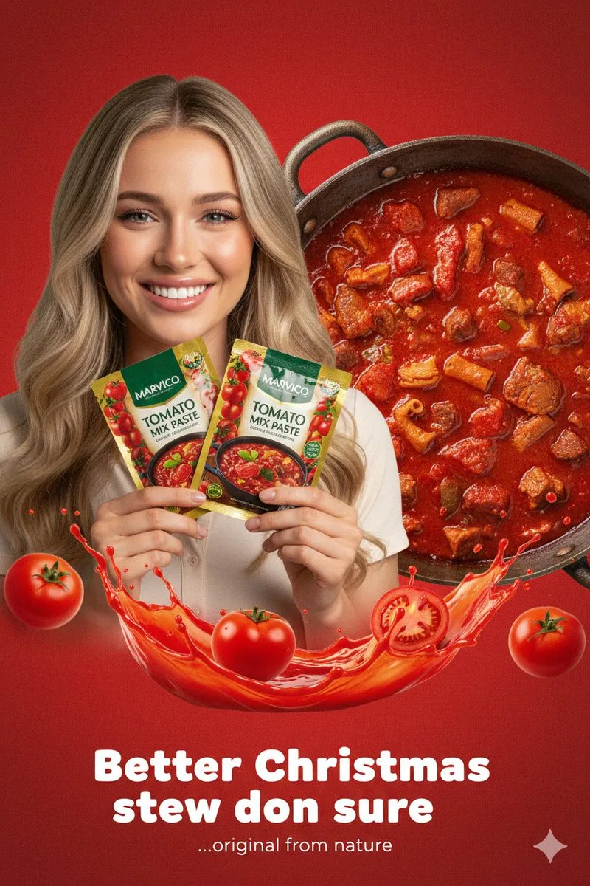

# Sharon Riley — by @Just_sharon7

[← Back to Community Examples](../../EXAMPLES.md) · Category: Food & Drink · Model: `Nano Banana`

<a href="https://x.com/Just_sharon7/status/2011383874937663775"></a>

Source: **[@Just_sharon7 on X](https://x.com/Just_sharon7/status/2011383874937663775)** · Creator: [Sharon Riley](https://x.com/Just_sharon7)

## Prompt

```text
{
  "subject": {
    "primary": "Two foil sachets of Marvico Tomato Mix Paste seasoning tilted diagonally",
    "secondary": "A rustic metal pot filled with rich, bubbling red Nigerian-style tomato stew containing assorted meats and tripe",
    "details": [
      "Vibrant red tomato sauce consistency",
      "Fresh whole tomato splash at the bottom foreground",
      "Sachets feature green and gold 'MARVICO' branding with realistic tomato illustrations",
      "A cheerful young Western blonde woman with long hair, wearing a casual bright outfit, holding the sachets and smiling at the camera"
    ]
  },
  "composition": {
    "layout": "Dynamic vertical advertisement",
    "focal_point": "Product sachets held by the girl in the center-left, overlapping a large pot of stew in the top-right",
    "background": "Solid textured red gradient with a subtle grainy paper effect",
    "perspective": "Eye-level with a slight Dutch angle for energy"
  },
  "typography": {
    "main_text": "Better Christmas stew don sure",
    "sub_text": "...original from nature",
    "font_style": "Bold, playful white bubble script for main text; minimalist lowercase sans-serif for sub-text",
    "placement": "Centered at the bottom over the red background"
  },
  "color_palette": {
    "dominant": ["Crimson Red", "Deep Scarlet"],
    "accents": ["Forest Green", "Metallic Gold", "Bright White"],
    "lighting": "Studio lighting with high contrast to make the red sauce look glossy and appetizing"
  },
  "style_descriptors": [
    "Commercial food photography",
    "West African culinary aesthetic",
    "High-definition textures",
    "Vibrant and warm color grading",
    "Professional product placement",
    "Lifestyle advertising with a relatable model"
  ],
  "technical_settings": {
    "aspect_ratio": "4:5",
    "sharpness": "High",
    "texture": "Subtle film grain on the background"
  }
}
```

## Try it

Paste the prompt into **[vinano.ai](https://vinano.ai?utm_source=github&utm_medium=readme&utm_campaign=awesome-image-video-prompts-updating&utm_content=x-page-try)** to generate your own version.

> The image and prompt belong to @Just_sharon7 ([original post](https://x.com/Just_sharon7/status/2011383874937663775)) and are shown here with credit for reference. Creators can ask for changes or removal by opening an issue.
