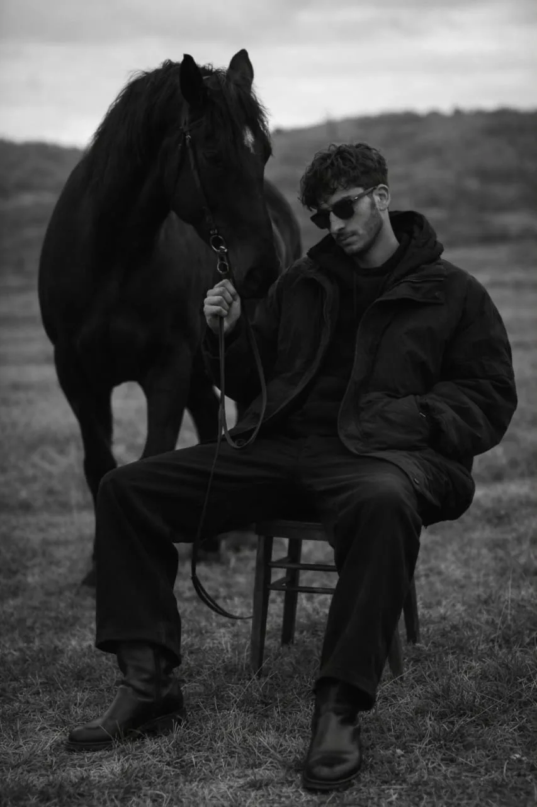

# Maercih — by @Maercihh

[← Back to Examples from X](../../EXAMPLES.md) · Category: Photography · Model: `Nano Banana`

<a href="https://x.com/Maercihh/status/2009835486144279008"></a>

Original post: **[@Maercihh on X](https://x.com/Maercihh/status/2009835486144279008)** · Creator: [Maercih](https://x.com/Maercihh)

## Prompt

```text
{
  "model": "Nano Banana Pro",
  "scene": "Open field landscape under an overcast sky, minimal natural surroundings",
  "subject": {
    "type": "Young man",
    "pose": "Seated on a wooden chair, legs relaxed apart, holding a horse lead calmly",
    "expression": "Detached, introspective, controlled",
    "gaze": "Looking downward, partially obscured by sunglasses",
    "emotion": "Quiet dominance, solitude, inner gravity"
  },
  "appearance": {
    "hair": {
      "color": "Dark",
      "style": "Short, slightly tousled curls"
    },
    "facial_features": {
      "beard": "Light stubble",
      "accessories": ["Dark sunglasses"]
    },
    "skin": "Natural texture, matte finish"
  },
  "attire": {
    "outerwear": "Oversized dark padded jacket",
    "innerwear": "Dark hoodie",
    "pants": "Relaxed-fit dark trousers",
    "footwear": "Black leather boots",
    "style_note": "Minimalist, masculine, utilitarian fashion"
  },
  "secondary_subject": {
    "type": "Black horse",
    "position": "Standing beside the man, head lowered slightly",
    "interaction": "Held calmly by a loose lead",
    "symbolism": "Strength, instinct, controlled power"
  },
  "environment": {
    "location": "Open grassy field",
    "background": [
      "Rolling hills",
      "Soft distant landscape",
      "No urban elements"
    ],
    "atmosphere": "Quiet, isolated, contemplative"
  },
  "lighting": {
    "type": "Natural diffused daylight",
    "conditions": "Overcast sky",
    "effect": "Soft shadows, low contrast, even tonal range"
  },
  "camera": {
    "angle": "Eye-level to slightly low-angle",
    "lens": "50mm cinematic portrait lens",
    "depth_of_field": "Moderate, subject and horse in focus, background gently blurred",
    "framing": "Vertical, full-body portrait with symbolic spacing"
  },
  "color_palette": {
    "mode": "Black and white",
    "tones": ["deep blacks", "soft grays", "muted highlights"]
  },
  "mood": "Stoic, restrained, powerful",
  "style": {
    "aesthetic": "Fine-art editorial portrait",
    "realism": "Photorealistic",
    "inspiration": "Minimalism, masculinity, symbolism",
    "post_processing": "High-quality monochrome grading, subtle film grain, soft contrast"
  },
  "details": {
    "chair": "Simple wooden chair, understated",
    "lead_tension": "Loose, intentional calm",
    "motion": "Stillness dominates the frame"
  },
  "themes": [
    "Controlled power",
    "Man and instinct",
    "Silence as authority",
    "Strength without display"
  ],
  "quality": "Ultra-detailed, cinematic black-and-white portrait with editorial depth"
}
```

## Try it

Paste the prompt into **[vinano.ai](https://vinano.ai?utm_source=github&utm_medium=readme&utm_campaign=awesome-image-video-prompts-updating&utm_content=x-page-try)** to generate your own version.

> The image and prompt belong to [@Maercihh](https://x.com/Maercihh) and are shown here with credit for reference. Creators can ask for changes or removal by opening an issue.
