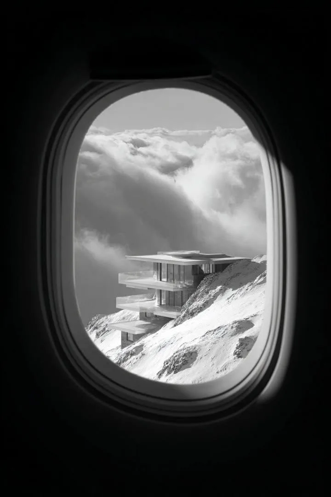

# 𝐌 — by @Strength04_X

[← Back to Community Examples](../../EXAMPLES.md) · Category: Photography · Model: `Nano Banana`

<a href="https://x.com/Strength04_X/status/2011050049258865019"></a>

Source: **[@Strength04_X on X](https://x.com/Strength04_X/status/2011050049258865019)** · Creator: [𝐌](https://x.com/Strength04_X)

## Prompt

```text
a window looking out an airplane and you can see a 4k image of a futuistic, very modern house on top of a mountain with snow, nothing is surrounding the house expect clouds, and snow the angle in which the photo is taken is. slightly from above, the picture is black and white and looks like it was shot on camera, the photo is taken straight out the window not from the side.
```

## Try it

Paste the prompt into **[vinano.ai](https://vinano.ai?utm_source=github&utm_medium=readme&utm_campaign=awesome-image-video-prompts-updating&utm_content=x-page-try)** to generate your own version.

> The image and prompt belong to @Strength04_X ([original post](https://x.com/Strength04_X/status/2011050049258865019)) and are shown here with credit for reference. Creators can ask for changes or removal by opening an issue.
