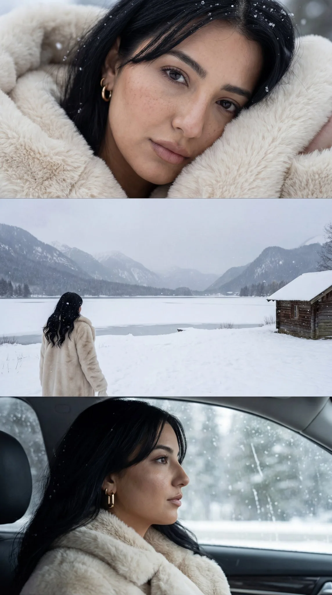

# Özge Döner — by @astronomerozge1

[← Back to Examples from X](../../EXAMPLES.md) · Category: Photography · Model: `Nano Banana`

<a href="https://x.com/astronomerozge1/status/2007883620862890340"></a>

Original post: **[@astronomerozge1 on X](https://x.com/astronomerozge1/status/2007883620862890340)** · Creator: [Özge Döner](https://x.com/astronomerozge1)

## Prompt

```text
{
  "generation_request": {
    "meta_data": {
      "tool": "NanoBanana Pro",
      "task_type": "text_to_image_cinematic_editorial_triptych",
      "version": "v1.0_WINTER_CINEMATIC_TRIPTYCH_3_STRIPS",
      "priority": "highest"
    },
    "output_settings": {
      "aspect_ratio": "4:5",
      "orientation": "portrait",
      "resolution": "ultra_high_res",
      "render_style": "ultra_photoreal_cinematic_editorial",
      "sharpness": "crisp_but_natural",
      "film_grain": "subtle_analog",
      "color_grade": "cool_winter_filmic",
      "retouch_level": "editorial_minimal_keep_texture",
      "noise_reduction": "low"
    },
    "composition": {
      "layout": "single image composed as a 3-panel vertical triptych (three horizontal strips stacked top/middle/bottom)",
      "panel_borders": "thin clean separators, no text, no frames, no watermark",
      "overall_style": "cohesive cinematic series with consistent color, lensing, and snowfall"
    },
    "lighting_and_camera": {
      "lighting": "soft overcast winter daylight, diffused, gentle contrast",
      "lens": "85mm for close portrait, 35mm for landscape, 50mm for car profile",
      "aperture": "f/2.8 portrait panels, f/5.6 landscape panel",
      "iso": "200-400",
      "shutter": "1/250"
    },
    "creative_prompt": {
      "scene_summary": "Create ONE single ultra-photoreal cinematic editorial image as a three-strip triptych (top/middle/bottom).\n\nTOP PANEL (close beauty):\n- Extreme close-up of a young woman’s face nestled into a plush cream faux-fur hood/coat collar.\n- Visible natural freckles across nose and cheeks, realistic pores and skin texture (no plastic smoothing).\n- Copper/red hair with soft bangs, a few snowflakes melting on hair and fur.\n- Gold hoop earrings (subtle luxury).\n- Expression: calm, slightly wistful, eyes looking toward camera.\n\nMIDDLE PANEL (wide landscape):\n- Wide shot of a frozen lake and snowy field with distant mountains.\n- A small wooden cabin on the right side of frame (cozy, rustic), light snow falling.\n- The same woman seen from behind/three-quarter angle on the left, wearing the same cream fur coat with hood.\n- Cinematic negative space, gentle atmospheric haze, crisp winter air.\n\nBOTTOM PANEL (car profile):\n- Inside a car, side profile portrait of the same woman seated by the window.\n- Snow visible outside through the window; soft reflections on glass.\n- She wears the same cream fur coat; red hair flowing, gold geometric/rectangular earring detail.\n- Expression: thoughtful, looking forward (not at camera).\n\nCOHESION REQUIREMENTS:\n- Maintain the same woman identity across all three panels.\n- Consistent winter color palette: cool blues/greys with warm skin tones and cream fur.\n- Natural snowfall across all panels; snowflakes scale and motion should be realistic.\n- Premium editorial feel, photoreal, cinematic continuity.\n\nNo text, no logos, no watermark."
    },
    "hard_constraints": [
      "ONE single image containing THREE horizontal panels stacked vertically.",
      "Same woman identity across all panels.",
      "Cream faux-fur hood/coat in all panels.",
      "Natural freckles and realistic skin texture.",
      "Photoreal snowfall (no fake bokeh dots).",
      "No text, no logos, no watermark."
    ],
    "negative_prompt": [
      "text",
      "logo",
      "watermark",
      "cartoon",
      "anime",
      "cgi",
      "over-retouched skin",
      "plastic skin",
      "identity drift between panels",
      "extra people",
      "distorted face",
      "warped hands",
      "fake looking snow",
      "oversharpening",
      "harsh flash lighting"
    ]
  }
}
```

## Try it

Paste the prompt into **[vinano.ai](https://vinano.ai?utm_source=github&utm_medium=readme&utm_campaign=awesome-image-video-prompts-updating&utm_content=x-page-try)** to generate your own version.

> The image and prompt belong to [@astronomerozge1](https://x.com/astronomerozge1) and are shown here with credit for reference. Creators can ask for changes or removal by opening an issue.
