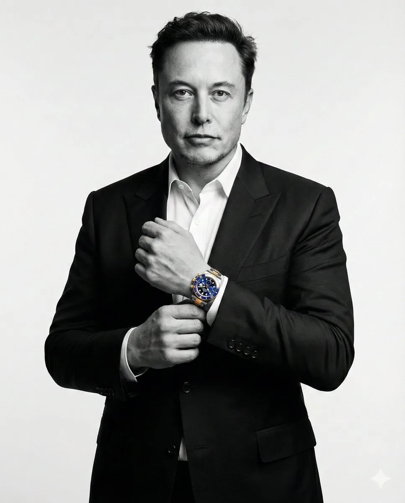

# Max — by @Max__Build

[← Back to Community Examples](../../EXAMPLES.md) · Category: Photography · Model: `Nano Banana`

<a href="https://x.com/Max__Build/status/2017469861811859752"></a>

Source: **[@Max__Build on X](https://x.com/Max__Build/status/2017469861811859752)** · Creator: [Max](https://x.com/Max__Build)

## Prompt

```text
8K Ultra-Realistic Promotional
High contrast black-and-white luxury editorial photograph of a confident Elon Musk wearing a perfectly tailored suit, standing against a clean studio backdrop. He is adjusting his wristwatch with his right hand on his left wrist in a poised, powerful gesture, drawing strong visual focus to an elegant luxury wristwatch displayed in full color. Sharp, dramatic studio lighting with deep shadows, sculpted jawline, high definition facial contours, crisp textures of premium suit fabric, refined masculine energy. Cinematic contrast, shallow depth of field, ultra sharp details, hyper-real clarity, photorealistic finish, premium European aesthetics, timeless and sleek composition, ultr polished luxury watch advertisement style, no noise, no blur, no imperfections, high dynamic range, and image size 4 5.
```

## Try it

Paste the prompt into **[vinano.ai](https://vinano.ai?utm_source=github&utm_medium=readme&utm_campaign=awesome-image-video-prompts-updating&utm_content=x-page-try)** to generate your own version.

> The image and prompt belong to @Max__Build ([original post](https://x.com/Max__Build/status/2017469861811859752)) and are shown here with credit for reference. Creators can ask for changes or removal by opening an issue.
