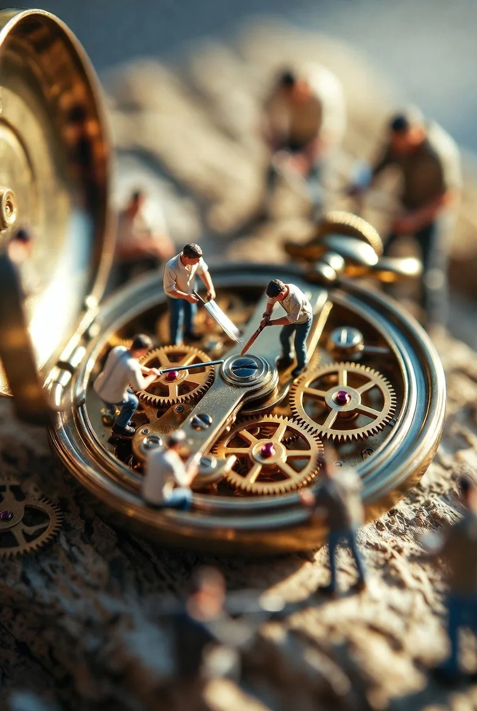

# Sindhu Sherni🦁 — by @SindhuK66662473

[← Back to Examples from X](../../EXAMPLES.md) · Category: Illustration & 3D · Model: `Nano Banana`

<a href="https://x.com/SindhuK66662473/status/2011688509665657263"></a>

Original post: **[@SindhuK66662473 on X](https://x.com/SindhuK66662473/status/2011688509665657263)** · Creator: [Sindhu Sherni🦁](https://x.com/SindhuK66662473)

## Prompt

```text
Ultra-realistic macro scene depicting tiny restoration workers collaboratively repairing an antique pocket watch. Several figures delicately clean intricate brass gears using fine brushes, while others stabilize the open watch casing and hold miniature components in place. The pocket watch lies on a textured natural surface, such as weathered wood or stone, emphasizing age and history. The scene symbolizes time, patience, craftsmanship, and teamwork.",
  "style": {
    "photography_type": "Macro photography",
    "realism": "Ultra-realistic",
    "mood": "Emotional and cinematic",
    "lighting": "Soft, warm, directional lighting with gentle highlights and natural shadows",
    "depth_of_field": "Shallow depth of field with sharp focus on foreground details and smooth background bokeh"
  },
  "composition": {
    "shot_type": "Close-up macro",
    "angle": "Slightly elevated perspective",
    "focus": "Extreme detail on gears, tools, and figurines’ interactions",
    "framing": "Pocket watch centered with workers distributed naturally across the mechanism"
  },
  "textures_and_details": {
    "materials": "Aged metal, polished brass gears, worn leather strap, natural surface grain",
    "details": "Visible dust particles, subtle scratches, fingerprints, and mechanical wear"
  },
  "atmosphere": {
    "tone": "Warm, nostalgic, hopeful",
    "symbolism": "Restoration of time through collective effort and care"
  },
  "render_settings": {
    "aspect_ratio": "4:5",
    "quality": 2,
    "resolution": "High-resolution",
    "style_precision": "Professional studio-level composition"
  }
}
```

## Try it

Paste the prompt into **[vinano.ai](https://vinano.ai?utm_source=github&utm_medium=readme&utm_campaign=awesome-image-video-prompts-updating&utm_content=x-page-try)** to generate your own version.

> The image and prompt belong to [@SindhuK66662473](https://x.com/SindhuK66662473) and are shown here with credit for reference. Creators can ask for changes or removal by opening an issue.
