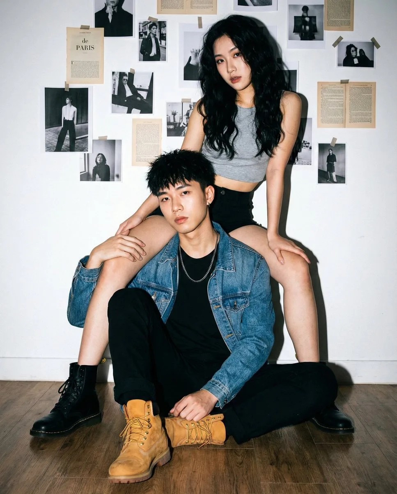

# Iqra Saifi — by @IqraSaifiii

[← Back to Examples from X](../../EXAMPLES.md) · Category: Photography · Model: `Nano Banana`

<a href="https://x.com/IqraSaifiii/status/2011780502546759715"></a>

Original post: **[@IqraSaifiii on X](https://x.com/IqraSaifiii/status/2011780502546759715)** · Creator: [Iqra Saifi](https://x.com/IqraSaifiii)

## Prompt

```text
"Young Asian couple, cool/edgy fashion models.",
      "female_hair": "Long, black, naturally little wavy hair (soft waves, not crimped), smooth texture with flyaways.",
      "male_hair": "Short, black, textured messy cut.",
      "outfits": {
        "female": "Grey crop top, black shorts, bare legs.",
        "male": "Blue denim jacket, black t-shirt, silver chain, blue jeans (one leg rolled up), mismatched boots (black combat boot on left, tan work boot on right)."
      }
    },
    "exact_pose_anatomical": {
      "male_pose": {
        "position": "Seated on the floor, facing forward.",
        "legs": "Left leg bent at knee, foot planted flat. Right leg bent inwards (cross-legged style) resting on the floor.",
        "arms": "Right arm resting casually on his own right knee. Left arm reaching up and back to hold the female's thigh securely.",
        "posture": "Leaning slightly forward, relaxed spine."
      },
      "female_pose": {
        "position": "Perched/Kneeling directly behind the male subject.",
        "legs": "Straddling the male subject's left shoulder. Her left thigh is draped over his shoulder, shin hanging down in front of his chest. Her right leg is tucked behind him (kneeling on the floor).",
        "arms": "Right hand resting on top of the male's right shoulder for balance. Left arm obscured.",
        "posture": "Torso upright, looming over the male figure.",
        "head": "Tilted slightly to the left, chin up."
      }
    },
    "camera_technical_values": {
      "perspective": "Low Angle / Eye-level with seated subjects.",
      "focal_length": "35mm (Capturing the full interaction and wall context).",
      "lighting": "Direct On-Camera Flash. Hard shadows cast directly behind the subjects on the wall.",
      "environment": "White wall with taped B&W photos and vintage book pages ('de PARIS'). Wooden floor."
```

## Try it

Paste the prompt into **[vinano.ai](https://vinano.ai?utm_source=github&utm_medium=readme&utm_campaign=awesome-image-video-prompts-updating&utm_content=x-page-try)** to generate your own version.

> The image and prompt belong to [@IqraSaifiii](https://x.com/IqraSaifiii) and are shown here with credit for reference. Creators can ask for changes or removal by opening an issue.
