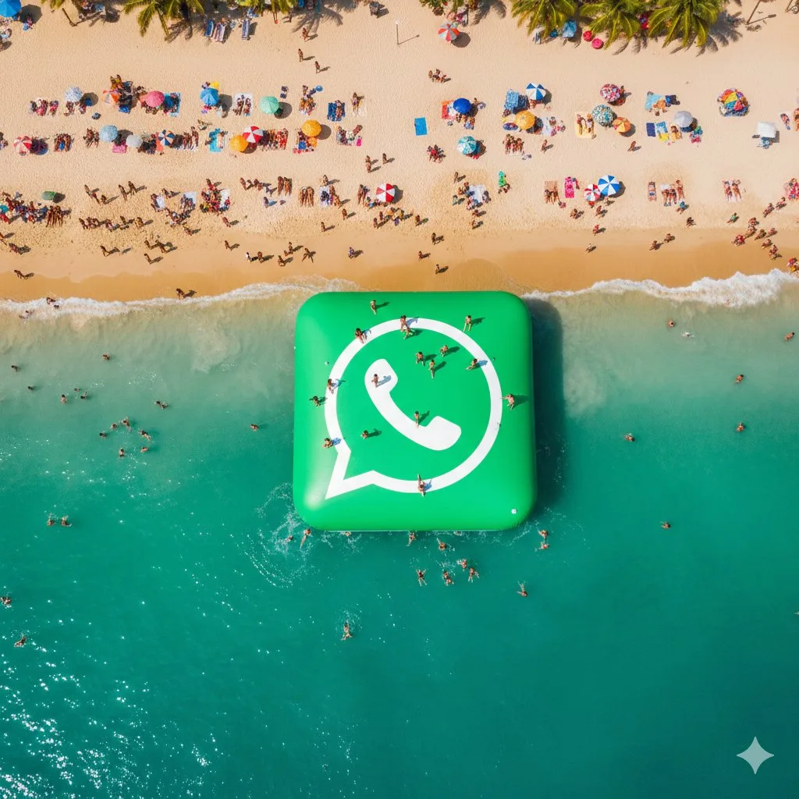

# Sharon Riley — by @Just_sharon7

[← Back to Community Examples](../../EXAMPLES.md) · Category: Illustration & 3D · Model: `Nano Banana`

<a href="https://x.com/Just_sharon7/status/2011422517156860056"></a>

Source: **[@Just_sharon7 on X](https://x.com/Just_sharon7/status/2011422517156860056)** · Creator: [Sharon Riley](https://x.com/Just_sharon7)

## Prompt

```text
{
  "prompt": "massive giant inflatable WhatsApp logo floating in the ocean near the beach, huge rectangular green mermaid logo with white siren face, long flowing white wavy hair, green crown with stars, ultra-detailed brand-accurate WhatsApp siren, enormous 100-meter diameter inflatable platform, emerald green rubber texture with subtle glossy highlights, classic green and white color scheme, dozens of people in swimsuits playing and lying on the giant inflatable, some standing, some sitting, some swimming around the edges, tropical beach setting, golden sand, turquoise ocean waves gently crashing around the edges, bright sunny day, aerial drone top-down perspective, very wide angle overhead shot, crystal clear water, people casting small shadows on the white face, vibrant summer atmosphere, advertising campaign style, hyperrealistic, extremely detailed, 8k",
  "negative_prompt": "text, letters, words, deformed, blurry, low resolution, bad anatomy, extra limbs, watermark, logo in corner, people inside the face, dark mood, night, winter, snow, ugly, cartoon, illustration, painting, sketch, 3d render, plastic toy look",
  "aspect_ratio": "16:9",
  "style": "photorealistic",
  "lighting": "bright natural sunlight, golden hour rim light, soft shadows",
  "camera": "drone aerial view, directly overhead, 200mm lens, slight wide angle distortion",
  "quality_tags": "masterpiece, best quality, ultra detailed, highly detailed, sharp focus, cinematic lighting, 8k resolution"
}
```

## Try it

Paste the prompt into **[vinano.ai](https://vinano.ai?utm_source=github&utm_medium=readme&utm_campaign=awesome-image-video-prompts-updating&utm_content=x-page-try)** to generate your own version.

> The image and prompt belong to @Just_sharon7 ([original post](https://x.com/Just_sharon7/status/2011422517156860056)) and are shown here with credit for reference. Creators can ask for changes or removal by opening an issue.
