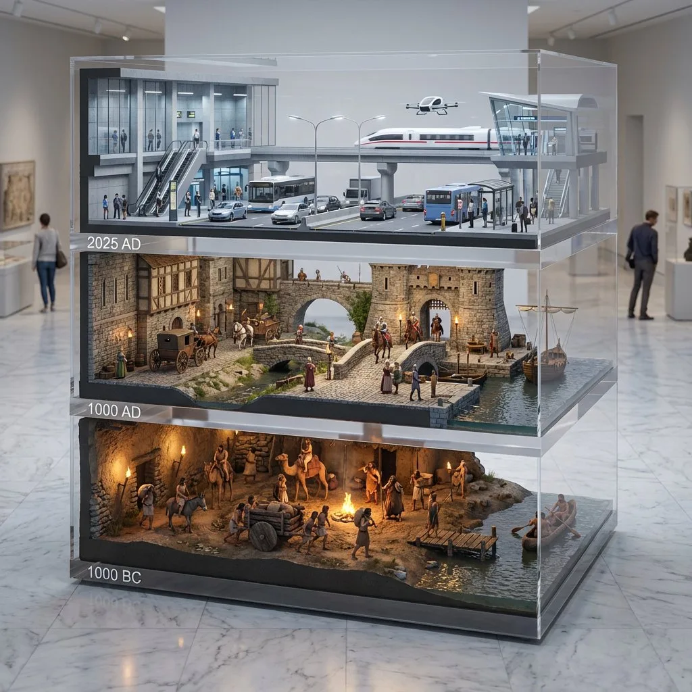

# Gadgetify — by @Gdgtify

[← Back to Community Examples](../../EXAMPLES.md) · Category: Illustration & 3D · Model: `Nano Banana`

<a href="https://x.com/Gdgtify/status/2013661551182348601"></a>

Source: **[@Gdgtify on X](https://x.com/Gdgtify/status/2013661551182348601)** · Creator: [Gadgetify](https://x.com/Gdgtify)

## Prompt

```text
Cinematic, hyper-realistic. A stacked depth composition of ultra-detailed 16K 3D-scanned transportation evolving over time, each layer at 1:18 scale with [ELEMENTS = era-relevant elements, scenes, vehicles]. Mounted on an acrylic stack base with refractive layers. Foreground lighting penetrates to cast multi-layered, receding shadows. From front to back: - [ "1000 BC" ]: [hyper realistic, era relevant ELEMENTS] - [ "1000 AD" ]: [hyper realistic, era relevant ELEMENTS ] - [ "2025 AD" ]: [hyper realistic, era relevant ELEMENTS ] Set against a marble background. Ultra-realistic 4K HDR render.
```

## Try it

Paste the prompt into **[vinano.ai](https://vinano.ai?utm_source=github&utm_medium=readme&utm_campaign=awesome-image-video-prompts-updating&utm_content=x-page-try)** to generate your own version.

> The image and prompt belong to @Gdgtify ([original post](https://x.com/Gdgtify/status/2013661551182348601)) and are shown here with credit for reference. Creators can ask for changes or removal by opening an issue.
