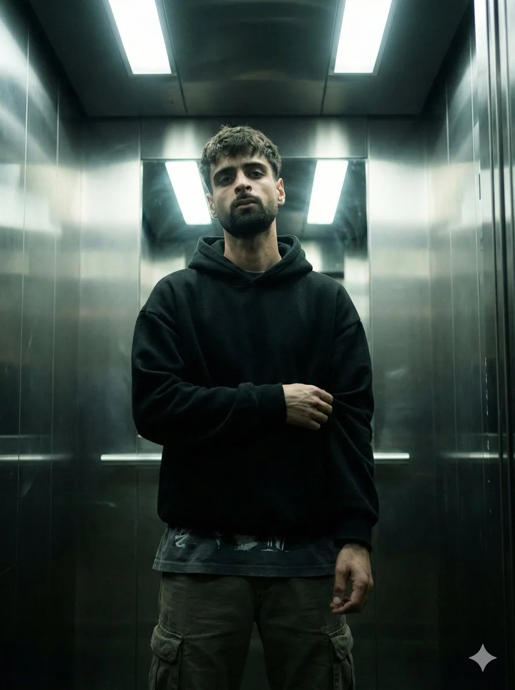

# Maercih — by @Maercihh

[← Back to Examples from X](../../EXAMPLES.md) · Category: Photography · Model: `Nano Banana`

<a href="https://x.com/Maercihh/status/2012032403620131316"></a>

Original post: **[@Maercihh on X](https://x.com/Maercihh/status/2012032403620131316)** · Creator: [Maercih](https://x.com/Maercihh)

## Prompt

```text
{
    "genre": "cinematic urban realism",
    "mood": ["tense", "cold", "isolated", "quiet intensity"],
    "theme": "a man caught in a moment of silence inside a sterile industrial elevator"
  },
  "subject": {
    "description": "young man with calm intense expression",
    "face": {
      "skin": "natural pores, realistic texture, slight under-eye shadow, no retouching",
      "beard": "short trimmed beard, natural density",
      "expression": "neutral but intimidating, relaxed jaw, eyes locked on camera"
    },
    "hair": {
      "style": "messy short crop",
      "detail": "slight volume on top, natural uneven strands, not styled too clean"
    },
    "pose": {
      "body_language": "still and grounded, subtle confidence",
      "hands": "one arm folded across torso, other arm relaxed downward",
      "stance": "centered, shoulders slightly forward, minimal movement"
    }
  },
  "wardrobe": {
    "top": "oversized black hoodie, heavy fabric, matte texture",
    "layering": "dark graphic tee slightly visible below the hoodie hem",
    "bottom": "dark cargo pants with stitched pockets",
    "styling_notes": "streetwear minimal, clean silhouette, no bright branding"
  },
  "environment": {
    "location": "metal elevator interior",
    "materials": ["brushed stainless steel walls", "reflective panels", "subtle fingerprints and smudges"],
    "lighting_elements": "overhead fluorescent light panels",
    "atmosphere": "thin mist/smoke floating around subject, faint haze near corners",
    "background": "no extra people, no clutter, clean symmetrical elevator geometry"
  },
  "cinematography": {
    "shot_type": "medium-full portrait",
    "framing": "perfect symmetrical centered composition",
    "camera_angle": "slightly low angle for dominance and tension",
    "lens": {
      "focal_length": "35mm",
      "look": "cinematic wide portrait with depth",
      "distortion_control": "minimal distortion, straight vertical elevator lines"
    },
    "depth_of_field": {
      "aperture": "f/2.8",
      "focus": "sharp focus on eyes and face",
      "falloff": "soft background blur but still readable environment"
    }
  },
  "lighting": {
    "type": "overhead harsh fluorescent top-light",
    "contrast": "medium-high with deep shadows under jaw and hoodie folds",
    "highlights": "soft bloom on metallic walls, controlled, not blown out",
    "fill": "very subtle ambient bounce to keep facial details visible",
    "notes": "keep lighting realistic and slightly underexposed for cinematic tension"
  },
  "color_grade": {
    "style": "dark cinematic teal-green industrial grade",
    "shadows": "cool teal tint",
    "highlights": "neutral to slightly cold",
    "saturation": "muted low saturation",
    "contrast": "clean but gritty",
    "black_levels": "slightly crushed blacks, not fully clipped"
  },
  "texture_details": {
    "skin": "realistic pores and micro texture",
    "fabric": "hoodie fleece texture visible, natural folds and weight",
    "metal": "subtle reflections, tiny scratches, elevator realism",
    "grain": "subtle film grain throughout"
  },
  "post_processing": {
    "sharpness": "sharp only on face, not over-sharpened",
    "vignette": "soft vignette around corners",
    "haze": "light haze for depth separation",
    "final_finish": "cinematic, grounded, documentary realism"
  },
  "negative_prompt": [
    "plastic skin",
    "beauty retouch",
    "anime",
    "cartoon",
    "overly smooth face",
    "HDR glow",
    "over-saturated colors",
    "extreme bokeh",
    "warped elevator walls",
    "extra fingers",
    "distorted hands",
    "unrealistic reflections",
    "text",
    "logos",
    "watermark"
  ],
  "output_settings": {
    "aspect_ratio": "3:4 vertical portrait",
    "resolution": "high detail",
    "quality": "photorealistic",
    "style": "cinematic realism"
  }
}
```

## Try it

Paste the prompt into **[vinano.ai](https://vinano.ai?utm_source=github&utm_medium=readme&utm_campaign=awesome-image-video-prompts-updating&utm_content=x-page-try)** to generate your own version.

> The image and prompt belong to [@Maercihh](https://x.com/Maercihh) and are shown here with credit for reference. Creators can ask for changes or removal by opening an issue.
