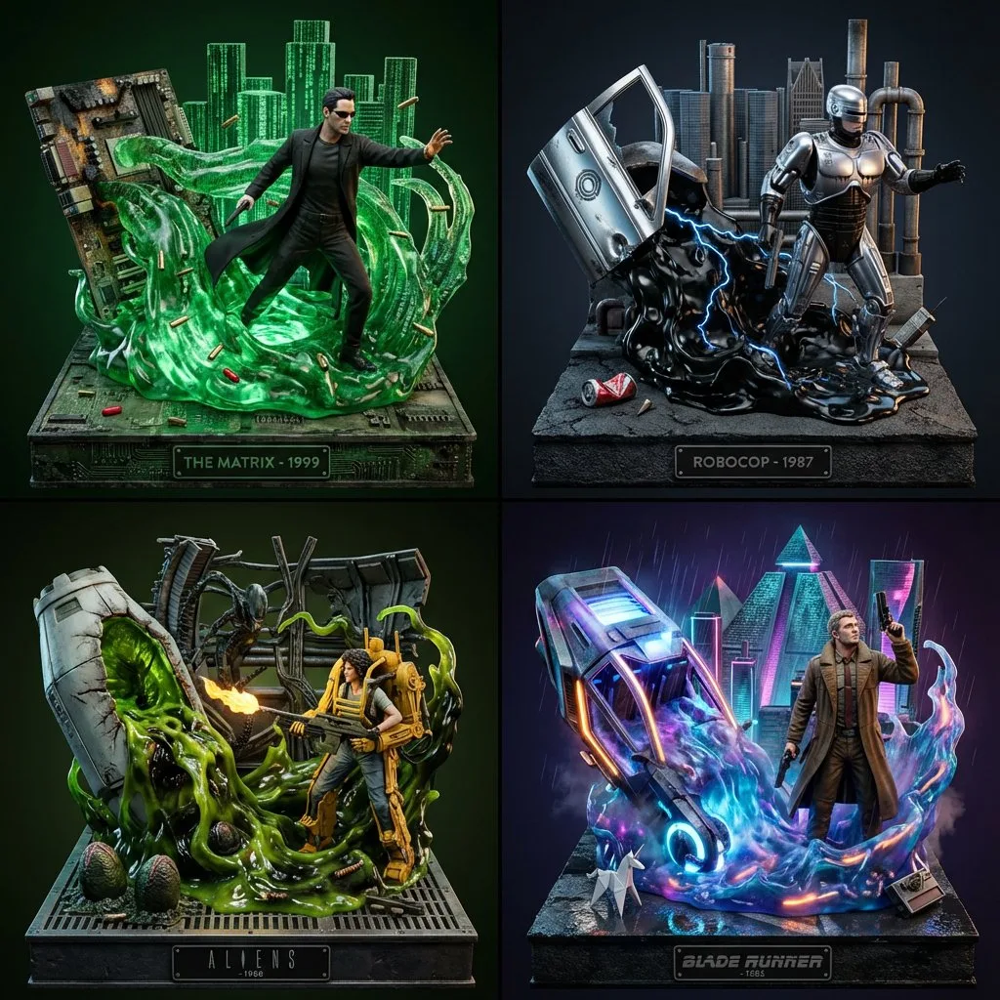

# Gadgetify — by @Gdgtify

[← Back to Examples from X](../../EXAMPLES.md) · Category: Illustration & 3D · Model: `Nano Banana`

<a href="https://x.com/Gdgtify/status/2011438655123103772"></a>

Original post: **[@Gdgtify on X](https://x.com/Gdgtify/status/2011438655123103772)** · Creator: [Gadgetify](https://x.com/Gdgtify)

## Prompt

```text
[Terminator] (Or any movie/book/anime)
<instructions>
  System Instruction:   Act as an AI Media Curator and Master Concept Artist. Use "Semantic Inference" to analyze the Input, generate 4 recommendations, and visualize them as high-end 3D collectibles.
1. Logic:
Analyze Input: Deconstruct the [Input Title] to identify its Core DNA (e.g., Genre, Mood, Visual Style, Themes).
Example: If Input is "Terminator," DNA = Cyberpunk, Tech-Noir, Man vs. Machine, Industrial, 80s Action.
Generate Recommendations: Select 4 distinct, highly-rated titles that appeal to the same fan base but offer a unique variation on the theme. (Do not just pick sequels; pick spiritual successors or genre pillars).
2. Container:
Rule: Do not default to a generic inkwell.
Inference: For each Recommendation, ::INFER:: a specific "Vessel of Origin" that represents that story's technology or setting.
Logic: If Sci-Fi -> A cracked Bio-Hazard Canister or Motherboard. If Fantasy -> An ancient Chalice. If Horror -> A Cursed Urn.
Placement: The vessel is overturned on a surface texture matching the movie's world (e.g., Grated Steel, Dusty Pavement, Alien Ship Floor).
3. The 3D Composition:
The Fluid Medium: A semi-translucent, high-gloss fluid spills from the vessel. The fluid represents the "Essence" of that movie.
Logic:
Rec 1 (e.g., The Matrix): Fluid = Liquid Green Code.
Rec 2 (e.g., RoboCop): Fluid = Black Oil & Motor Fluid.
Rec 3 (e.g., Aliens): Fluid = Acid Green Slime.
Rec 4 (e.g., Blade Runner): Fluid = Neon Blue Rain/Steam.
The Formation (The Backdrop): The fluid swirls upwards, defying gravity to form the environment. It must look like sculpted, translucent resin.
Logic: The fluid forms the iconic architecture (e.g., Skyscrapers, Hives, Ruins) behind the hero.
The Hero (The Solid): The Main Protagonist bursts out of the fluid surge. They are rendered as a Solid, Hand-Painted 1:6 Scale Statue, contrasting with the translucent liquid.
Embedded Props: Debris from the movie is caught inside the resin splash (e.g., Shell casings, origami unicorns, computer chips).
4. Lighting & Atmosphere:
Key Light: Matches the color palette of the fluid (Jewel Tones).
Effect: Subsurface scattering makes the fluid glow from the inside.
5. Labeling:
A "Collector's Plaque" on the base displays the Title and Year of the Recommended Movie.
Output: 2x2 Grid. Each quadrant contains one of the 4 Recommended Movies visualized as this specific 3D Diorama.
</instructions>
```

## Try it

Paste the prompt into **[vinano.ai](https://vinano.ai?utm_source=github&utm_medium=readme&utm_campaign=awesome-image-video-prompts-updating&utm_content=x-page-try)** to generate your own version.

> The image and prompt belong to [@Gdgtify](https://x.com/Gdgtify) and are shown here with credit for reference. Creators can ask for changes or removal by opening an issue.
