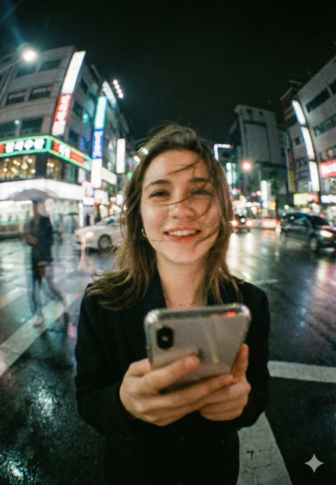

# Maercih — by @Maercihh

[← Back to Examples from X](../../EXAMPLES.md) · Category: Photography · Model: `Nano Banana`

<a href="https://x.com/Maercihh/status/2013478541753753795"></a>

Original post: **[@Maercihh on X](https://x.com/Maercihh/status/2013478541753753795)** · Creator: [Maercih](https://x.com/Maercihh)

## Prompt

```text
{
  "model": "gemini-nano-banana-pro",
  "mode": "image",
  "aspect_ratio": "4:5",
  "quality": "ultra",
  "style": "cinematic_realism",
  "scene": {
    "setting": "busy neon-lit city street at night, wet road after rain, glowing signboards and traffic behind subject",
    "weather": "light drizzle just ended, reflective pavement, humid atmosphere",
    "background": "soft bokeh city lights, moving cars, faint pedestrian motion blur, tall buildings with colorful signage",
    "time": "night"
  },
  "subject": {
    "type": "young woman",
    "pose": "standing in the middle of a crosswalk, holding a smartphone close to camera",
    "expression": "natural warm smile, candid and joyful",
    "hair": "slightly messy hair blown across face by wind",
    "wardrobe": "dark coat or blazer, minimal accessories",
    "props": ["smartphone"]
  },
  "composition": {
    "framing": "close-up portrait with wide-angle distortion, subject centered, phone in foreground",
    "camera_distance": "very close, intimate street-photo feel",
    "perspective": "wide lens perspective, slight fisheye look, background stretching outward",
    "depth_of_field": "shallow to medium, subject readable but background lights creamy",
    "foreground_detail": "phone and hands slightly soft due to motion and lens character"
  },
  "camera": {
    "lens": "24mm wide-angle (slight fisheye character)",
    "aperture": "f/1.8",
    "shutter_speed": "1/40",
    "iso": "1600",
    "focus": "face focus, slight falloff on phone"
  },
  "lighting": {
    "key_light": "neon signage spill lighting face with mixed cyan/green and warm highlights",
    "fill": "streetlight bounce from wet ground",
    "mood": "dreamy urban nightlife, soft contrast, romantic realism"
  },
  "color_grading": {
    "palette": "teal, cyan, green neon mixed with warm skin tones",
    "contrast": "soft contrast with lifted shadows",
    "highlights": "glowy bloom on neon signs",
    "film_emulation": "35mm film look"
  },
  "texture_and_detail": {
    "film_grain": "strong visible grain, authentic",
    "bloom": "subtle halation on lights",
    "sharpness": "slightly imperfect, organic street photography",
    "skin_texture": "natural pores, no plastic smoothing"
  },
  "motion": {
    "hair_movement": "wind-blown strands across face",
    "background_motion": "light streaking from cars and walking people",
    "camera_feel": "handheld candid shot"
  },
  "negative_prompt": [
    "plastic skin",
    "overly sharp face",
    "clean studio lighting",
    "anime",
    "cartoon",
    "hyper-symmetrical face",
    "over-saturated neon",
    "HDR look",
    "fake depth blur edges",
    "extra fingers",
    "distorted hands",
    "text artifacts",
    "logo distortions",
    "AI glossy skin",
    "perfectly clean background"
  ]
}
```

## Try it

Paste the prompt into **[vinano.ai](https://vinano.ai?utm_source=github&utm_medium=readme&utm_campaign=awesome-image-video-prompts-updating&utm_content=x-page-try)** to generate your own version.

> The image and prompt belong to [@Maercihh](https://x.com/Maercihh) and are shown here with credit for reference. Creators can ask for changes or removal by opening an issue.
