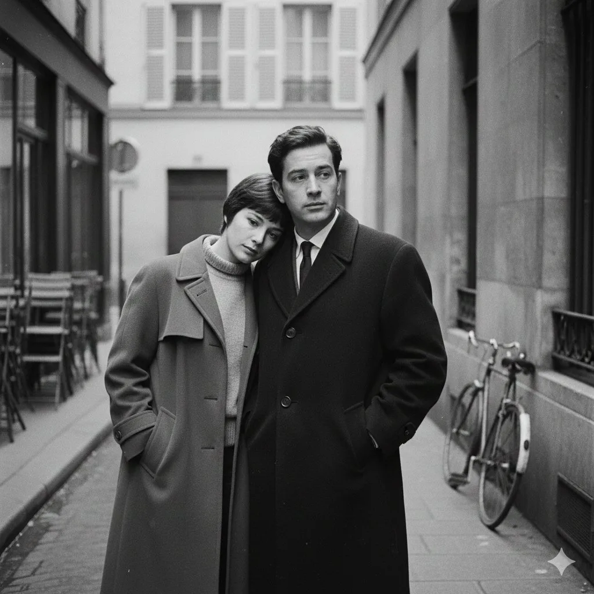

# Muhammad Waseem 🇵🇰 — by @Itswsm105f

[← Back to Community Examples](../../EXAMPLES.md) · Category: Photography · Model: `Nano Banana`

<a href="https://x.com/Itswsm105f/status/2015296685354721690"></a>

Source: **[@Itswsm105f on X](https://x.com/Itswsm105f/status/2015296685354721690)** · Creator: [Muhammad Waseem 🇵🇰](https://x.com/Itswsm105f)

## Prompt

```text
A French New Wave–style minimalist lovers scene, black and white, 1950s–1960s European cinema tone. A couple standing close but not touching, quiet intimacy expressed through proximity rather than action. The woman leans slightly toward the man; the man looks past her, thoughtful. Simple, understated clothing — trench coats, wool coats, knit sweaters, classic shirts. No glamour, no styling excess. Natural faces, minimal makeup, authentic expressions.
Set on an empty Parisian street or narrow European alley, early morning or overcast daylight. Café chairs stacked, a bicycle against a wall, stone textures, shuttered windows. Static camera, eye-level framing, wide negative space, imperfect composition. Soft natural light, gentle shadows, subtle 35mm film grain.
Emotion conveyed through stillness, silence, and unresolved tension — love present but unspoken. Minimal dialogue energy, poetic realism, quiet longing, human fragility. Inspired by Godard / Truffaut, anti-dramatic, observational cinema, timeless intimacy, restrained romance, art-house melancholy.
```

## Try it

Paste the prompt into **[vinano.ai](https://vinano.ai?utm_source=github&utm_medium=readme&utm_campaign=awesome-image-video-prompts-updating&utm_content=x-page-try)** to generate your own version.

> The image and prompt belong to @Itswsm105f ([original post](https://x.com/Itswsm105f/status/2015296685354721690)) and are shown here with credit for reference. Creators can ask for changes or removal by opening an issue.
