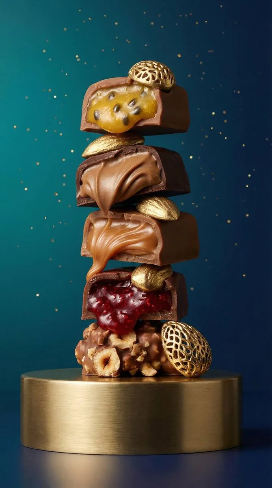

# Nas — by @Nas_tech_AI

[← Back to Community Examples](../../EXAMPLES.md) · Category: Food & Drink · Model: `Nano Banana`

<a href="https://x.com/Nas_tech_AI/status/2011592765570785538"></a>

Source: **[@Nas_tech_AI on X](https://x.com/Nas_tech_AI/status/2011592765570785538)** · Creator: [Nas](https://x.com/Nas_tech_AI)

## Prompt

```text
{
"style": "ultra-realistic food photography, luxury editorial, macro-detail, natural textures",
  "images": [
    {
      "id": "image_1",
      "subject": "assorted praline tower",
      "composition": "staggered vertical tower, center frame, loose organic stacking",
      "details": {
        "fillings": [
          "hazelnut chunks irregularly clumped at base",
          "raspberry gel naturally puddled",
          "salted caramel with realistic flow lines",
          "coffee ganache with smooth wave texture",
          "passionfruit filling with visible pulp specks"
        ],
        "accent": "one unique metallic gold nut per filling type placed at layer transitions",
        "stand": "brushed gold stand with subtle reflections"
      },
      "lighting": {
        "type": "dramatic side lighting",
        "angle": "35 degrees left",
        "effects": "authentic filling refractions, layered shadow play"
      },
      "background": "teal-to-navy gradient with suspended gold motes",
      "mood": "luxurious, indulgent, artisanal depth"
    },
    {
      "id": "image_2",
      "subject": "ruby chocolate tablet",
      "composition": "floating hexagonal segments above black textured paper liner",
      "details": {
        "surface": "hand-tempered imperfections, translucent ruby pink",
        "inclusions": "embedded fruit flecks visible through chocolate",
        "motion": "ruby cacao nibs falling in gravity-realistic arc from one segment"
      },
      "lighting": {
        "key": "top-down at 12 o'clock",
        "rim": "soft pink rim light at 3 o'clock",
        "effects": "authentic shadows, enhanced translucency"
      },
      "background": "black-to-warm pink radial gradient with subtle sparkle specks",
      "mood": "modern, vibrant, floating tension"
    },
    {
      "id": "image_3",
      "subject": "white chocolate bonbons",
      "composition": "organic cluster on clear glass stand",
      "details": {
        "marbling": [
          "central bonbon with irregular orange passionfruit veins",
          "surrounding bonbons with pink raspberry swirls",
          "green matcha flecks with varied density"
        ],
        "cutaway": "one bonbon sliced vertically showing gel core with real fruit speckles",
        "props": "dried fruit flecks scattered below (orange zest curls, raspberry seeds)"
      },
      "lighting": {
        "key": "soft high-key front light at 10 degrees",
        "rim": "rear rim light at 35 degrees",
        "effects": "enhanced marbling contrast and glass refractions"
      },
      "background": "soft taupe with fruit-toned bokeh",
      "mood": "elegant, fresh, handcrafted"
    },
    {
      "id": "image_5",
      "subject": "dark chocolate pistachio bar",
      "composition": "vertical bar centered on polished black granite slab",
      "details": {
        "cross_section": "precision side cut revealing layered pistachio filling",
        "filling": "whole roasted green pistachios suspended in smooth white chocolate matrix",
        "binding": "subtle golden honey swirl",
        "break": "front broken segment with clean snap and visible pistachio pieces",
        "props": "whole roasted pistachios arranged in ascending curve, honey drips nearby"
      },
      "lighting": {
        "key": "soft spotlight from top-left at 45 degrees",
        "rim": "warm side rim light from right at 30 degrees",
        "highlight": "single pinpoint highlight on largest pistachio"
      },
      "background": "dark espresso brown gradient with floating pistachio shell dust particles",
      "mood": "rich, bold, premium indulgence"
    }
  ]
}
```

## Try it

Paste the prompt into **[vinano.ai](https://vinano.ai?utm_source=github&utm_medium=readme&utm_campaign=awesome-image-video-prompts-updating&utm_content=x-page-try)** to generate your own version.

> The image and prompt belong to @Nas_tech_AI ([original post](https://x.com/Nas_tech_AI/status/2011592765570785538)) and are shown here with credit for reference. Creators can ask for changes or removal by opening an issue.
