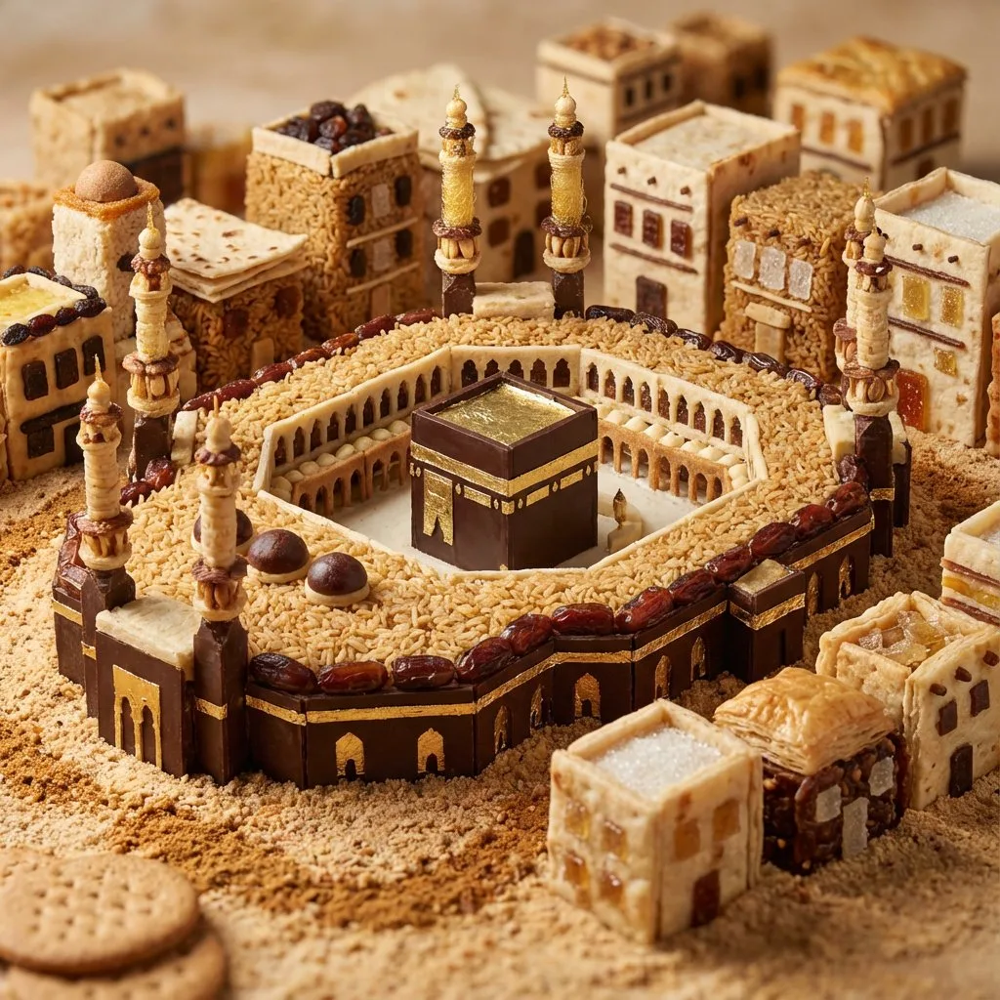

# Gadgetify — by @Gdgtify

[← Back to Examples from X](../../EXAMPLES.md) · Category: Illustration & 3D · Model: `Nano Banana`

<a href="https://x.com/Gdgtify/status/2009567700469809518"></a>

Original post: **[@Gdgtify on X](https://x.com/Gdgtify/status/2009567700469809518)** · Creator: [Gadgetify](https://x.com/Gdgtify)

## Prompt

```text
[Country/City Name]::4
Morphology: Miniature architectural cityscape, skyline constructed entirely from edible ingredients, tiny skyscrapers and houses mimicking [Country/City] architectural styles but formed from food, culinary structural engineering, hyper-detailed diorama::3
Material Physics: [Country/City] national gastronomy as construction material, native cuisine textures replacing concrete and glass, masonry made of regional staples, savory and sweet ingredient structural integrity, authentic local food palette::3
Illumination: Soft focus macro lighting, ambient occlusion, mouth-watering highlights::2
Render Stack: Tilt-shift photography, macro lens, f/2.8, 8k, scale model aesthetic, unreal engine 5 render::1
Negative: [Real concrete, real metal, plastic, inedible, humans, cutlery, plates, blurry]:: -1
```

## Try it

Paste the prompt into **[vinano.ai](https://vinano.ai?utm_source=github&utm_medium=readme&utm_campaign=awesome-image-video-prompts-updating&utm_content=x-page-try)** to generate your own version.

> The image and prompt belong to [@Gdgtify](https://x.com/Gdgtify) and are shown here with credit for reference. Creators can ask for changes or removal by opening an issue.
