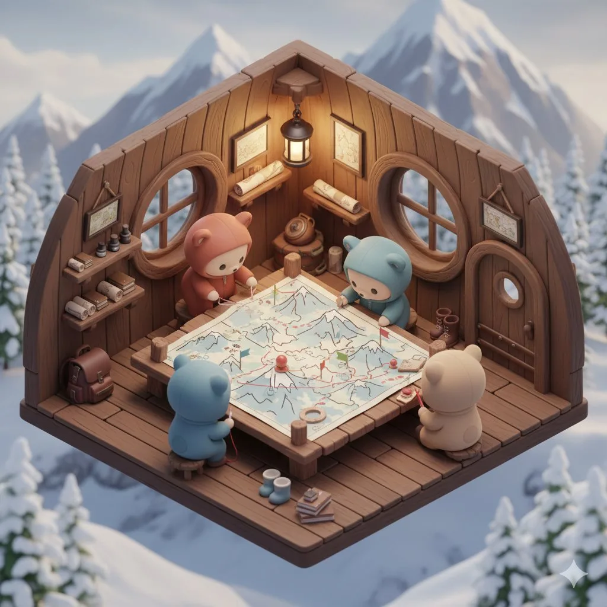

# Sharon Riley — by @Just_sharon7

[← Back to Community Examples](../../EXAMPLES.md) · Category: Illustration & 3D · Model: `Nano Banana`

<a href="https://x.com/Just_sharon7/status/2011747649398194268"></a>

Source: **[@Just_sharon7 on X](https://x.com/Just_sharon7/status/2011747649398194268)** · Creator: [Sharon Riley](https://x.com/Just_sharon7)

## Prompt

```text
{
  "prompt": "Isometric 3D kawaii scene of chibi baby bears designing a mountain snow map inside a cozy wooden hideout. The isometric cutaway room features a large hand-drawn map spread across a tilted work table, decorated with tiny flags, paw-print markers, and string lines connecting different locations. Three baby bears wear soft hooded outfits in warm terracotta, foggy blue, and oatmeal beige. One bear stands on a small stool placing a flag on the map, another measures distances using a string and wooden ruler, while the third sketches snowy paths with a crayon. The room includes wooden shelves filled with rolled maps, compasses, ink bottles, backpacks, and snow boots placed near the door. Small windows reveal snow-covered mountains and pine forests outside.",
  "style": {
    "art_style": "kawaii 3D",
    "perspective": "isometric cutaway",
    "geometry": "rounded, toy-like proportions",
    "render_type": "ultra-detailed 3D render"
  },
  "lighting": {
    "type": "warm indoor lighting",
    "mood": "soft and cozy",
    "contrast": "gentle highlights with smooth shadows"
  },
  "color_palette": {
    "primary": ["pastel earthy tones"],
    "accent": ["warm terracotta", "foggy blue", "oatmeal beige"]
  },
  "atmosphere": {
    "emotion": "wholesome and adventurous",
    "vibe": "cozy, playful, story-driven"
  },
  "quality": {
    "detail_level": "ultra detailed",
    "resolution": "8k",
    "rating": "masterpiece, premium quality"
  }
}
```

## Try it

Paste the prompt into **[vinano.ai](https://vinano.ai?utm_source=github&utm_medium=readme&utm_campaign=awesome-image-video-prompts-updating&utm_content=x-page-try)** to generate your own version.

> The image and prompt belong to @Just_sharon7 ([original post](https://x.com/Just_sharon7/status/2011747649398194268)) and are shown here with credit for reference. Creators can ask for changes or removal by opening an issue.
