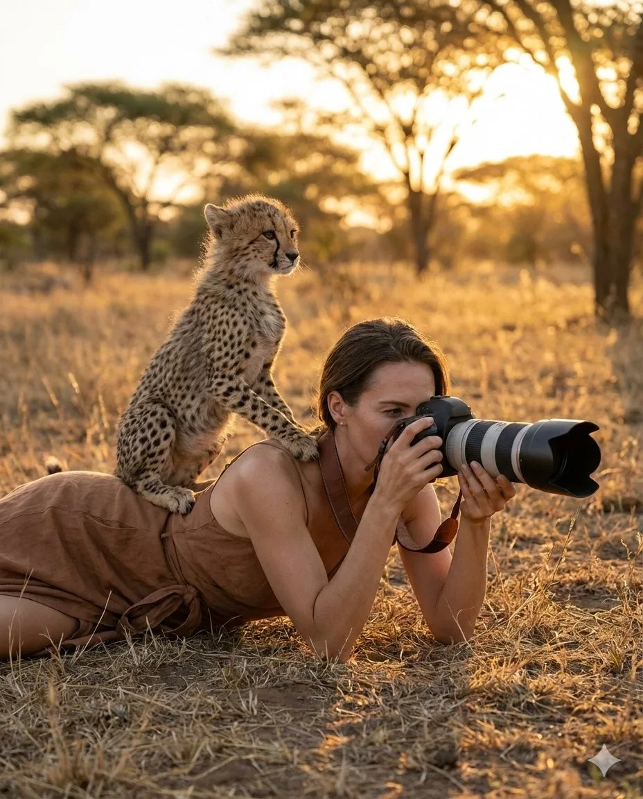

# Harboriis — by @harboriis

[← Back to Community Examples](../../EXAMPLES.md) · Category: Photography · Model: `Nano Banana`

<a href="https://x.com/harboriis/status/2009171824488403456"></a>

Source: **[@harboriis on X](https://x.com/harboriis/status/2009171824488403456)** · Creator: [Harboriis](https://x.com/harboriis)

## Prompt

```text
Ultra-realistic wildlife photography scene: An elegant woman in a minimal earthy-toned wrap dress with thin straps, lying flat on the grassy ground while holding a professional DSLR camera with a large telephoto lens, intently focusing on wildlife. A playful cheetah cub sits on her shoulder, curiously gazing into the distance. Golden hour natural light bathes the African savannah background, with cinematic depth of field, vibrant colors, and 8K ultra-detailed realism,4:5 image ratio.
```

## Try it

Paste the prompt into **[vinano.ai](https://vinano.ai?utm_source=github&utm_medium=readme&utm_campaign=awesome-image-video-prompts-updating&utm_content=x-page-try)** to generate your own version.

> The image and prompt belong to @harboriis ([original post](https://x.com/harboriis/status/2009171824488403456)) and are shown here with credit for reference. Creators can ask for changes or removal by opening an issue.
