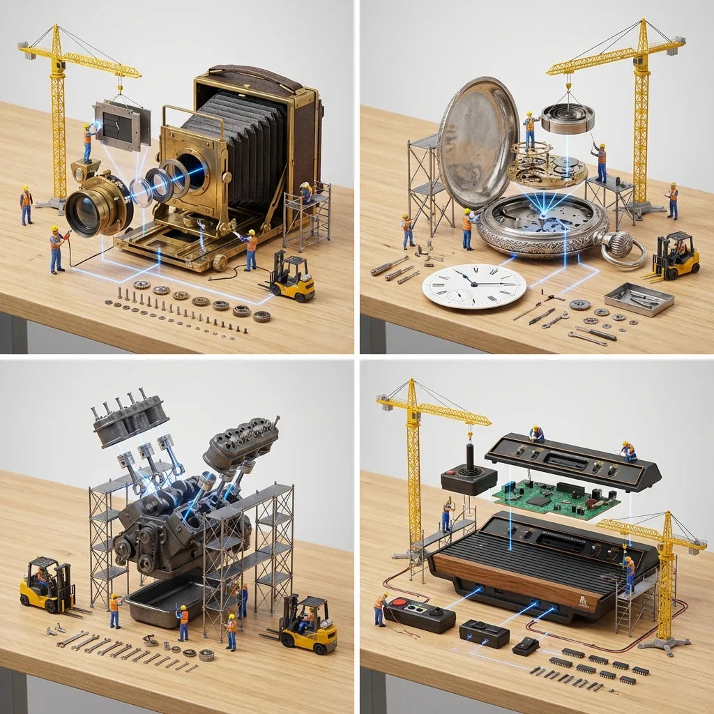

# Gadgetify — by @Gdgtify

[← Back to Examples from X](../../EXAMPLES.md) · Category: Illustration & 3D · Model: `Nano Banana`

<a href="https://x.com/Gdgtify/status/2017611578284401056"></a>

Original post: **[@Gdgtify on X](https://x.com/Gdgtify/status/2017611578284401056)** · Creator: [Gadgetify](https://x.com/Gdgtify)

## Prompt

```text
<instruction> 
 Input A is a Mechanical Device or Gadget (e.g., Vintage Camera, Mechanical Watch, V8 Engine, Game Console).
Deconstruct the object into 3 Functional Layers  :
      Chassis (The Shell):  Identify the main body frame or housing.
      Engine (The Guts):  Identify the primary internal mechanism.
         (e.g., Camera -> Shutter & Mirrors. Watch -> Mainspring & Escapement. Engine -> Pistons). 
      Interface (The Control):  Identify the buttons, dials, or lens elements.

  2.  Container 
Goal: "Exploded Construction" Tabletop Photography.
     Surface:  A clean, light-grain   Wooden Workbench   or cutting mat.
     Layout:    Exploded View (Knolling).   The machine is pulled apart into its components, which are arranged spatially to show how they fit together.

  3. Construction 
     The Suspension:  Major parts (The Chassis) are raised on   Miniature Scaffolding   or suspended by   Miniature Yellow Cranes  .
     The Narrative:  A crew of   1:87 Scale Construction Workers   (Hard hats, vests) are actively building the machine.
         Action:  They are welding gears, hoisting the lens, or consulting blueprints on the table.
         Vehicles:  Tiny forklifts or flatbed trucks are delivering screws and springs.

  4. Visual  
     The Guide Lines:  Thin, glowing   Blue Laser Lines   or holographic wires connect the separated parts, tracing the path of assembly from the table to the suspended parts.
     The Hardware:  Tiny screws, washers, and springs are lined up neatly in rows (Knolling style) on the table, waiting to be installed.

  5. Lighting & Atmosphere:  
     Lighting:    Bright Studio Light.   Even, shadowless illumination (High Key) to ensure every mechanical detail is visible.
     Texture:  Contrast between the matte grey/black of the machine parts and the bright yellow of the construction equipment.

  Output:   ONE image, 1:1 Aspect Ratio, Macro Photography, "Miniature World" aesthetic, Technical Precision.
</instruction>
```

## Try it

Paste the prompt into **[vinano.ai](https://vinano.ai?utm_source=github&utm_medium=readme&utm_campaign=awesome-image-video-prompts-updating&utm_content=x-page-try)** to generate your own version.

> The image and prompt belong to [@Gdgtify](https://x.com/Gdgtify) and are shown here with credit for reference. Creators can ask for changes or removal by opening an issue.
