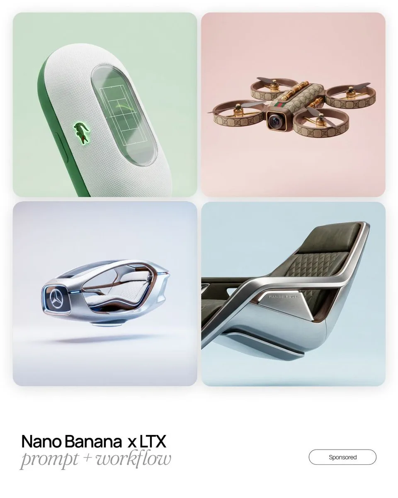

# AmirMušić — by @AmirMushich

[← Back to Examples from X](../../EXAMPLES.md) · Category: Product & Brand · Model: `Nano Banana`

<a href="https://x.com/AmirMushich/status/2017682012987970042"></a>

Original post: **[@AmirMushich on X](https://x.com/AmirMushich/status/2017682012987970042)** · Creator: [AmirMušić](https://x.com/AmirMushich)

## Prompt

```text
[BRAND NAME] design language, object reimagined as an unexpected flagship product of the brand for the next decade. Crafted from signature materials and textures. Distinctive aesthetics, iconic form factor, embodiment of brand philosophy, high-end industrial design.
 
COMPOSITION & STAGING:

The object is floating suspended in mid-air within the studio space (anti-gravity effect). It is positioned strictly dead center in the frame.

Negative Space: There is a wide, generous margin of empty space (air) surrounding the object on all sides.
Framing: The object is fully contained within the image boundaries with absolutely no cropping.

PHOTOGRAPHY:

Professional product photography, soft volumetric lighting, clean light pastel background, ultra-detailed.
```

## Try it

Paste the prompt into **[vinano.ai](https://vinano.ai?utm_source=github&utm_medium=readme&utm_campaign=awesome-image-video-prompts-updating&utm_content=x-page-try)** to generate your own version.

> The image and prompt belong to [@AmirMushich](https://x.com/AmirMushich) and are shown here with credit for reference. Creators can ask for changes or removal by opening an issue.
