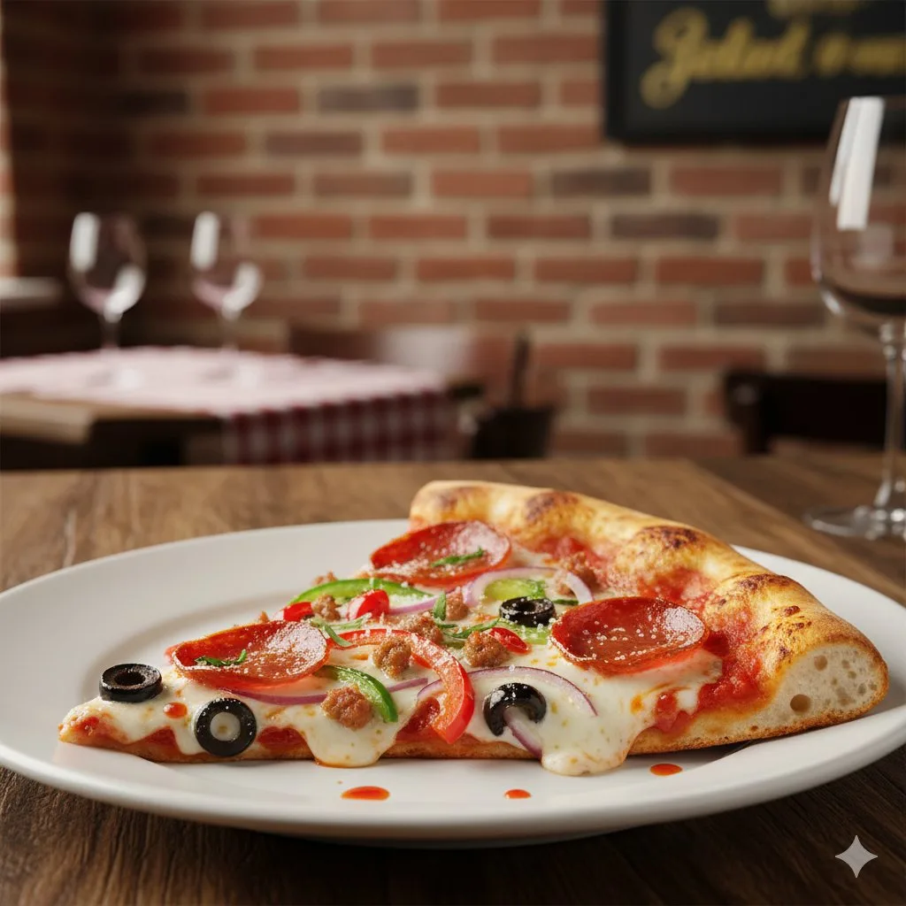

# Cuties — by @cuties7377

[← Back to Community Examples](../../EXAMPLES.md) · Category: Food & Drink · Model: `Nano Banana`

<a href="https://x.com/cuties7377/status/2010528965018927520"></a>

Source: **[@cuties7377 on X](https://x.com/cuties7377/status/2010528965018927520)** · Creator: [Cuties](https://x.com/cuties7377)

## Prompt

```text
{
  "content_goal":
 "viral food photography post",
  "image_type": 
"professional food photography",
  "food_concept": {
    "item": 
"pizza slice",
    "style": 
"premium artisan pizza",
    "serving_state": 
"freshly lifted slice with cheese pull",
    "temperature_feel": 
"hot, freshly baked"
  },
  "visual_style": {
    "aesthetic": "cinematic food editorial",
    "vibe": "crave-worthy, indulgent, luxurious",
    "realism": "ultra-realistic"
  },
  "composition": {
    "framing": "close-up macro with partial pizza visible",
    "angle": "45-degree side angle",
    "focus_point": "cheese stretch and toppings",
    "depth_of_field": "shallow background blur"
  },
  "pizza_details": {
    "crust": "golden-brown, crispy edges with soft interior",
    "cheese": "melted mozzarella with long stretchy pull",
    "sauce": "rich red tomato sauce",
    "toppings": [
      "pepperoni slices",
      "fresh basil leaves",
      "olive oil glaze"
    ],
    "texture": "glossy cheese, crisp crust, juicy toppings"
  },
  "lighting": {
    "type": "soft directional studio lighting",
    "direction": "side light for texture definition",
    "highlight": "cheese shine and crust detail",
    "shadow": "soft natural shadows"
  },
  "color_palette": {
    "primary_colors": [
      "cheese yellow",
      "tomato red",
      "golden brown"
    ],
    "contrast_level": "medium-high",
    "mood": "warm, appetizing, mouth-watering"
  },
  "environment": {
    "surface": "rustic wooden table or marble slab",
    "background": "dark blurred restaurant or kitchen",
    "props": [
      "pizza cutter",
      "linen napkin",
      "wooden board"
    ]
  },
  "camera_details": {
    "lens": "macro or 50mm food lens",
    "focus": "extreme sharpness on slice",
    "resolution": "high-end commercial quality",
    "noise": "none"
  },
  "sensory_impact": {
    "visual_effect": "cheese pull in motion",
    "viewer_reaction": "instant craving",
    "emotional_trigger": "comfort food desire"
  },
  "quality_control": {
    "food_realism": "authentic pizza texture",
    "ai_artifacts": "none",
    "professional_finish": "restaurant advertisement grade"
  },
  "intended_use": {
    "primary": "viral food post on X",
    "secondary": "restaurant promo, food brand content"
  }
}
```

## Try it

Paste the prompt into **[vinano.ai](https://vinano.ai?utm_source=github&utm_medium=readme&utm_campaign=awesome-image-video-prompts-updating&utm_content=x-page-try)** to generate your own version.

> The image and prompt belong to @cuties7377 ([original post](https://x.com/cuties7377/status/2010528965018927520)) and are shown here with credit for reference. Creators can ask for changes or removal by opening an issue.
