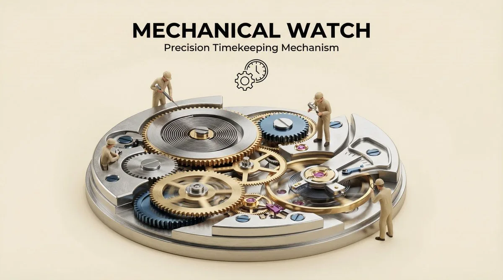

# Aleena Amir — by @aleenaamiir

[← Back to Community Examples](../../EXAMPLES.md) · Category: Illustration & 3D · Model: `Nano Banana`

<a href="https://x.com/aleenaamiir/status/2018147539992862866"></a>

Source: **[@aleenaamiir on X](https://x.com/aleenaamiir/status/2018147539992862866)** · Creator: [Aleena Amir](https://x.com/aleenaamiir)

## Prompt

```text
Create a clear, 45° top-down isometric miniature 3D cutaway diorama showing the inside of [MACHINE / DEVICE].

Use soft refined textures, realistic PBR materials, and clean technical lighting.

Design a raised base with visible internal components, wiring, gears, or energy flow paths.
Include tiny stylized technicians interacting with the machinery (no facial details).

Use a clean solid [BACKGROUND COLOR] background.

At the top-center, display [MACHINE NAME] in large bold text, beneath it show a short technical subtitle, and place a minimal engineering icon below.

All text must automatically match the background contrast (white or black).
```

## Try it

Paste the prompt into **[vinano.ai](https://vinano.ai?utm_source=github&utm_medium=readme&utm_campaign=awesome-image-video-prompts-updating&utm_content=x-page-try)** to generate your own version.

> The image and prompt belong to @aleenaamiir ([original post](https://x.com/aleenaamiir/status/2018147539992862866)) and are shown here with credit for reference. Creators can ask for changes or removal by opening an issue.
