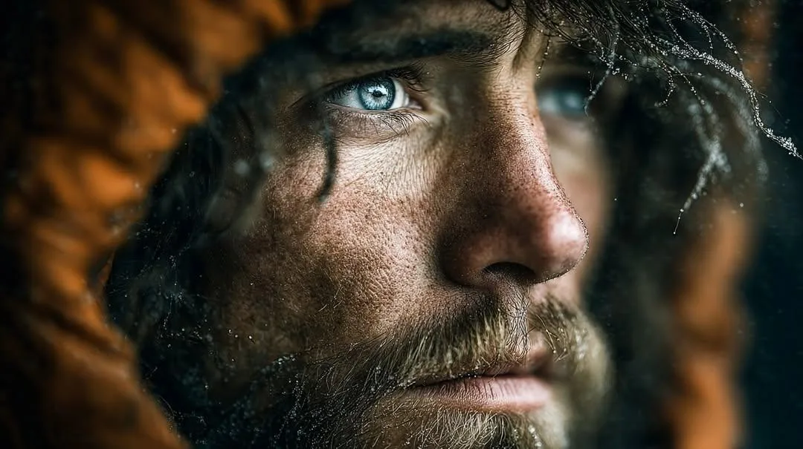

# Taaruk — by @Taaruk_

[← Back to Community Examples](../../EXAMPLES.md) · Category: Photography · Model: `Nano Banana`

<a href="https://x.com/Taaruk_/status/2011453009553969357"></a>

Source: **[@Taaruk_ on X](https://x.com/Taaruk_/status/2011453009553969357)** · Creator: [Taaruk](https://x.com/Taaruk_)

## Prompt

```text
{
  "Objective": "Create an intense cinematic close-up portrait conveying survival, resilience, and raw human strength in a harsh winter environment",
  "PersonaDetails": {
    "Subject": {
      "Type": "Rugged adult man",
      "Eyes": {
        "Color": "Piercing icy blue",
        "Focus": "Primary focal point of the image, razor sharp"
      },
      "FacialFeatures": {
        "Beard": "Thick, full beard",
        "Skin": "Weathered with visible pores, fine texture, and subtle scars"
      },
      "Expression": "Intense, stoic, emotionally restrained",
      "Wardrobe": {
        "Outerwear": "Heavy winter coat with fur-lined hood",
        "Framing": "Hood partially framing the face"
      }
    }
  },
  "EnvironmentalDetails": {
    "Season": "Winter",
    "Atmosphere": "Cold, harsh, unforgiving",
    "Snow": {
      "Details": "Snowflakes clinging to hair, eyelashes, eyebrows, and beard",
      "Motion": "Frozen mid-air and resting naturally on facial hair"
    }
  },
  "Composition": {
    "Framing": "Extreme close-up portrait",
    "Crop": "Tight crop emphasizing eyes and facial texture",
    "DepthOfField": "Very shallow depth of field",
    "Focus": "Ultra-sharp on eyes, soft falloff toward edges"
  },
  "LightingAndMood": {
    "LightingStyle": "Dramatic low-key cinematic lighting",
    "KeyLight": "Soft, directional light sculpting facial structure",
    "RimLight": "Cold rim light separating subject from background",
    "ColorGrading": "Moody cinematic tones with cold blues and warm brown accents",
    "Mood": "Intense, raw, powerful, solitary"
  },
  "ArtDirection": {
    "Style": "Hyper-realistic cinematic photography",
    "Aesthetic": "Survival realism, raw human endurance",
    "TextureEmphasis": [
      "Photorealistic skin pores",
      "Beard hair detail",
      "Fur-lined fabric texture",
      "Ice and snow particles"
    ]
  },
  "PhotographyStyle": {
    "Genre": "Cinematic survival portrait photography",
    "RealismLevel": "Extreme photorealism",
    "DetailLevel": "8K ultra-high detail with controlled sharpness"
  },
  "Theme": {
    "Concept": "Survival, resilience, endurance against nature",
    "EmotionalImpact": "Strength, determination, quiet defiance"
  },
  "NegativePrompt": [
    "smooth skin",
    "beauty retouching",
    "flat lighting",
    "low contrast",
    "cartoon",
    "anime",
    "fantasy illustration",
    "blurry eyes"
  ],
  "ResponseFormat": {
    "Type": "Single image",
    "Orientation": "Portrait",
    "AspectRatio": "2:3"
  }
}
```

## Try it

Paste the prompt into **[vinano.ai](https://vinano.ai?utm_source=github&utm_medium=readme&utm_campaign=awesome-image-video-prompts-updating&utm_content=x-page-try)** to generate your own version.

> The image and prompt belong to @Taaruk_ ([original post](https://x.com/Taaruk_/status/2011453009553969357)) and are shown here with credit for reference. Creators can ask for changes or removal by opening an issue.
